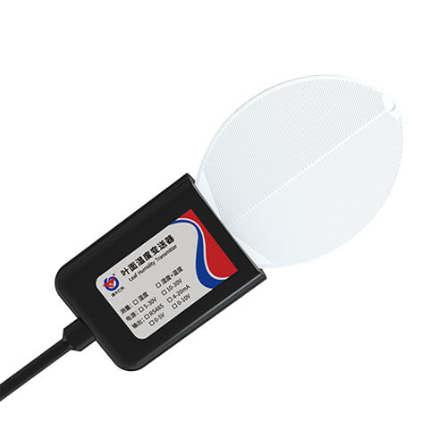
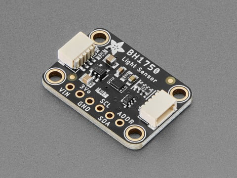
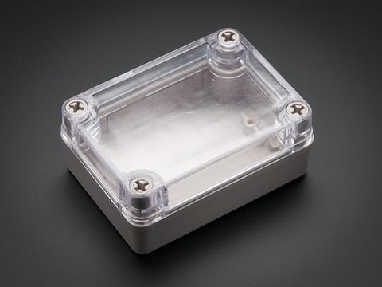

# AI-Powered Plant Health Monitoring and Disease Detection Using IoT & WSN

System: PlantGuard

Simran Batwal | Roll number: 28452500003

M.Tech | Computer Science | 3rd Semester

Guru Nanak Dev University, Amritsar

Guide: Dr. Anil Kumar

8 September 2026 | Initial-stage proposal

# Introduction and current progress

## About my project
My project is **AI-Powered Plant Health Monitoring and Disease Detection Using IoT & WSN**. I have named the system **PlantGuard**. I plan to use leaf photographs and environmental sensors to monitor plant health. A laptop will process the data and display the results.

I have discussed the topic with my guide and prepared an initial plan. I have also started reading related research papers. A detailed study of their methods, datasets and results is still in progress. I will finalise the scope with my guide before starting the main implementation.

| Work | Current progress |
| Topic selection | Topic discussed with my guide |
| Initial planning | Basic system flow and required components identified |
| Literature study | Preliminary reading started; detailed review in progress |
| Dataset preparation | Sources shortlisted; download and checking are the next steps |
| Hardware | Components shortlisted; purchase and assembly are pending |
| Coding and model training | Not started |
| Testing and results | Will begin after implementation |

## Purpose of this report
In this report, I explain the college prototype, the work already published in this area and the part I plan to study. I have included the hardware requirements, software choices, testing method and a proposed schedule.

At the next review, I would like to discuss whether the scope is suitable, which experiments should be given priority and what support is available for checking plant-disease labels.

# Abstract and problem statement

## Abstract
Plant diseases can affect plant growth and crop quality. A leaf photograph can help identify visible symptoms, while sensors can record the surrounding conditions. However, a blurred image, an unfamiliar disease or a faulty sensor may lead to an unreliable result.

In this project, I propose PlantGuard, a plant-health monitoring system using AI, IoT and a Wireless Sensor Network. The college setup will contain two tomato plants and two ESP32 sensor nodes. Each node will measure soil-moisture response, air temperature, relative humidity and leaf wetness. A phone or USB camera will capture leaf photographs. The readings and images will be processed on a laptop and shown on a dashboard.

I will first compare four image-classification models. I will then study how sensor information and input-quality checks can support the image result. When the information is unclear or incomplete, the system will show the problem and may ask for a fresh photograph. I will compare this approach with a simpler image-only system.

The expected outcome is a working two-node prototype and a comparison of its performance under clear, unclear and incomplete inputs. Disease forecasting and other extensions will depend on the availability of suitable data.

## Problem statement
How can I combine leaf images and environmental readings in a practical college prototype while reducing incorrect decisions caused by unclear images, missing readings or faulty sensors?

## Reason for selecting this topic
The project connects computer vision, embedded systems, networking and data analysis. Published work shows that good results on clean leaf images do not always carry over to different conditions [R1, R2]. I want to study this practical problem through a manageable prototype.

# Objectives and project scope

| Objective | What I plan to demonstrate |
| Wireless monitoring | Two sensor nodes send separate readings to a laptop |
| Image classification | Compare MobileNetV3 Large, ResNet50, EfficientNet-B0 and ViT |
| Sensor and image integration | Match each photograph with the correct plant, zone and time |
| Handling unclear inputs | Show low-quality, unknown or missing-data messages when needed |
| Performance comparison | Compare classification results, errors, response time and extra observations |
| User interface | Show readings, images, trends and reviewed management information |

## First prototype
I will start with tomato. The first image task will use healthy, early-blight and late-blight categories. Images outside the supported task should be rejected or marked for review. The physical setup will have two pots to demonstrate two measurement locations.

The two plants are for monitoring and integration tests. They will not be enough to prove disease forecasting or treatment effectiveness. For image-model experiments, I will use suitable labelled datasets and check their sources.

## Work to consider later
The wider plan includes potato, maize, apple, grape, pepper and rice. I will add these image categories only after checking the data and discussing the scope with my guide. The first physical setup will remain tomato-based.

Severity estimation, learned forecasting and continual learning will need additional labels and experiments. I will consider these after the main prototype is working. Automatic watering, spraying and solar power are not required for the first college setup.

# College architecture and data flow

**Architecture:** sensors -> ESP32 nodes A/B -> local Wi-Fi -> laptop broker/database -> laptop AI/dashboard. Camera -> zone/time-linked image intake on laptop.
Figure 1. Proposed college system. The arrows show data flow.

## Working sequence
1. The sensors take readings near each plant. Each ESP32 adds its node ID and reading status.
2. Both nodes send their readings over Wi-Fi to the laptop.
3. The application checks and stores the readings. It also records missing values and the last received time.
4. I capture a leaf photograph and select the plant and zone. The image is saved with its capture time.
5. The image model gives a result. The application looks up the relevant sensor history from the same zone.
6. The dashboard shows the image result, sensor conditions and any reason to take another observation.

## Role of each part
The **ESP32** reads sensors and sends data. The **laptop** runs the AI model, application and database. The **Wi-Fi access point** connects the devices. The **camera** provides the leaf image.

USB cables can supply power or help with debugging. The final sensor readings will still travel wirelessly. Once the required software and model files are installed, the college demonstration can run over a local network without an internet connection.

If I use a phone hotspot, I will first check whether it allows the laptop and nodes to communicate with each other.

# Physical setup and sensor placement

**Setup:** two labelled tomato pots with soil probes, shielded air sensors and separate supported wetness plates; a shared stable camera and laptop.
Figure 2. Proposed two-pot arrangement. This drawing shows placement, not electrical wiring.

| Component | Planned placement |
| Tomato plants | Two similar plants in labelled 10-15 L pots with drainage trays |
| Soil probe | In the root-zone medium; insertion depth will be recorded |
| SHT31 | Near the canopy, inside a ventilated shield and away from direct spray |
| Leaf-wetness plate | On a separate support near the leaves, following its installation instructions |
| Camera | On a stable stand at a suitable close-focus distance |
| ESP32 and wires | Above tray level, with protection from water and loose connections |

I will keep the potting medium and care routine as consistent as possible. I will record watering, visible changes, sensor movement and other changes around the plants.

The wetness plate acts as a surface near the plant; it does not measure every leaf directly. The two pots represent two monitored zones. They are not a complete biological trial.

The first demonstration can use labelled disease photographs. I will discuss access to real disease observations with my guide and a suitable plant expert before planning any such study.

# Controller and main sensors

[Product-family source](https://docs.espressif.com/projects/esp-idf/en/v4.3.6/esp32/hw-reference/esp32/get-started-devkitc.html)

[Product-family source](https://www.dfrobot.com/product-1385.html)

[Product-family source](https://www.adafruit.com/product/2857)

| Part | Planned choice |
| Controller | Two matching ESP32 DevKitC V4 boards with WROOM-32E modules [H1](https://docs.espressif.com/projects/esp-idf/en/stable/esp32/hw-reference/esp32/get-started-devkitc.html) |
| Soil sensor | Capacitive SEN0193-class probe [H2](https://wiki.dfrobot.com/Capacitive_Soil_Moisture_Sensor_SKU_SEN0193) |
| Air sensor | SHT31 temperature and humidity breakout [H3](https://www.adafruit.com/product/2857) |

## Why I selected ESP32
ESP32 has built-in Wi-Fi and suitable connections for the required sensors. I can program it using the Arduino framework. A separate Arduino Uno is therefore not required. I will check the exact board model, pin layout and cable connector before assembly.

## Soil moisture
The capacitive probe gives an electrical reading that changes with the surrounding medium. I will record the raw reading and calibrate the probe in the selected potting medium. The displayed value will be a relative moisture index. I will not treat it as an exact soil-water percentage without the required calibration.

## Temperature and humidity
SHT31 measures local air temperature and relative humidity. I selected it for the planned air measurements. It needs a suitable shield so that direct sunlight, water and heat from the electronics do not distort the readings.

The photographs show component families. I will confirm the actual model and electrical requirements from the supplier's documentation before buying or connecting them.

# Leaf wetness, camera and accessories

[Product-family source](https://www.renkeer.com/product/leaf-wetness-sensor/)

[Product-family source](https://www.adafruit.com/product/4681)

[Product-family source](https://www.adafruit.com/product/903)

## Leaf wetness
I plan to use a documented artificial leaf-wetness plate, such as an RS485 Modbus variant in the Renke RS-WS-*-YM-1-T family. I will confirm the exact model, supply voltage, output units and register details before ordering [H4](https://www.renkeer.com/product/leaf-wetness-sensor/). A 3.3 V MAX3485 interface is included for each node [H5](https://www.analog.com/en/products/max3485.html).

Air humidity and leaf wetness are different measurements. Humid air does not always mean that the leaf surface is wet. A basic rain-detection board will not be treated as an equivalent calibrated leaf-wetness sensor.

## Camera
I will use a phone or USB camera to capture a clear close-up of the leaf. Before selecting a webcam, I will check the image focus, exposure and mounting distance. A “1080p” label alone does not guarantee a clear close-up.

## Optional light measurement
BH1750 can record light level in lux [H6](https://www.adafruit.com/product/4681). It is optional for the first prototype. Lux is a measure of illuminance; it is not the same as the light measurement used for photosynthesis.

## Assembly items
The setup will also need breadboards, data cables, jumper wires, terminals, regulated power supplies, fuse protection, standoffs, enclosures, sensor supports, pots and trays. I will check the available laboratory tools before requesting any additional equipment.

# Connections and calibration

| Function | Planned interface on classic ESP32 DevKitC |
| SHT31 and optional BH1750 | I2C; candidate SDA GPIO21 and SCL GPIO22; verify breakout pull-ups at 3.3 V |
| Capacitive soil probe | ADC1 input, candidate GPIO34; verify the output stays within the selected ADC range |
| RS485 transceiver | UART, candidate RX GPIO16 / TX GPIO17, direction GPIO25; verify board availability |
| Power | Board through a verified USB supply; separate matched sensor supply where required |

I will use these pin choices as a starting point for the classic WROOM-32E board, not universal wiring instructions. I will check the exact modules and sensor manuals before switching on the circuit. ADC1 is chosen for soil sampling to avoid classic ESP32 ADC2/Wi-Fi resource conflicts.

## Calibration and commissioning sequence
1. Inspect part markings and supplies with a multimeter. Check polarity, common signal reference and logic voltage compatibility.
2. Read one sensor at a time before assembling the full node. Store raw readings and the sensor/model identifier.
3. Calibrate the soil response in the actual medium using repeatable reference states. Save calibration values separately for each probe.
4. Place the two air sensors together and compare stable readings. Record differences; use a reference instrument if available.
5. Check dry and uniformly wetted plate response according to its manual. Select a wet/dry threshold only from this evidence and retain the raw output.
6. Verify serial/register settings, then run both nodes continuously. Record gaps, resets and disagreement between co-located sensors.

I will record the calibration method and any differences between the sensors. This will help me explain the accuracy and limits of the measurements.

# Literature review 1: image generalisation

## R1. Mohanty, Hughes and Salathe (2016)
**Work done in the paper.** The study trained deep image classifiers using 54,306 controlled leaf images across 14 crops. It reported 99.35% held-out accuracy under its dataset conditions. Performance on differently sourced images was much lower, just above 31% in the paper's external test.

**Main limitation.** The difference between internal and external performance is more informative for PlantGuard than the high headline accuracy. Background and capture conditions can become shortcuts. 

**Use in my project.** I will keep separate tests for familiar and different capture conditions. I will also record image sources and keep related images in the same split [R1](https://doi.org/10.3389/fpls.2016.01419).

## R2. Singh et al. (2020)
**Work done in the paper.** PlantDoc introduced a web-collected, non-laboratory dataset with 2,598 data points spanning 13 plant species and up to 17 disease classes. Its focus is the practical difficulty of recognising disease beyond clean laboratory images.

**Main limitation.** This is a comparatively small and heterogeneous dataset. Image provenance, labels and repeated sources need auditing. Web collection is not the same as a planned local field study.

**Use in my project.** I will check the tomato labels and use suitable examples to test the image models under different conditions. These images will be used separately from my locally recorded sensor data [R2](https://arxiv.org/abs/1911.10317).

## Questions to take into full reading
Which split unit was used? How were duplicates handled? Which classes are comparable across datasets? What changes between the training environment and the external evaluation? I will record these details in my paper notes.

# Literature review 2: image-sensor fusion

## R3. Chen et al. (2024)
**Work done in the paper.** The peach-tree study combines image and sensor features for disease recognition and segmentation. It introduces an alignment mechanism to bring different feature representations together before using their combined information.

**Main limitation.** Results from peach trees need further testing before they can be applied to tomato and the sensors in my setup. In my detailed reading, I will check how samples were aligned, which modalities were removed in ablations and how independent evaluation data were separated.

**Use in my project.** Image-plus-sensor fusion is established prior work. I will focus on testing the use of unclear images and missing sensor information in the college setup [R3](https://doi.org/10.3390/agriculture14060797).

## R4. Gao et al. (2026)
**Work done in the paper.** This protected-horticulture study combines tomato leaf images with environmental time series and links risk estimates to greenhouse control. The authors report approximately 0.95 accuracy and more than 20 hours of warning in their study setting.

**Main limitation.** Their measurements arise from a real greenhouse dataset and a specific experimental protocol. A two-pot setup will need more disease observations before I can test early warning. In my detailed reading, I will check event labels, time splits and the information available before disease onset.

**Use in my project.** I will use this study to understand the difference between current diagnosis and future warning. I will collect matching timestamps and test early warning only if suitable disease-event records are available [R4](https://doi.org/10.3390/horticulturae12030299).

## Proposed review outcome
I will discuss with my guide whether the main study should focus on reliable diagnosis or forecasting. Forecasting will require data showing the conditions before actual disease events.

# Literature review 3: unfamiliar conditions

## R5. Wei et al. (2024)
**Work done in the paper.** PlantWild addresses disease recognition in varied real-world imagery and introduces a multimodal baseline using image and text information. It studies the difficulty of distinguishing similar diseases under diverse appearance conditions.

**Main limitation.** Image-text multimodality is different from image-environmental-sensor fusion. Dataset versions and licence terms must be tracked; the project lists non-commercial terms that require separate consideration for any later product use.

**Use in my project.** I will use this work to understand changes in image conditions. I will check the classes and permission to use the data before including it [R5, D3].

## R6. Dong et al. (2025)
**Work done in the paper.** The paper studies anomaly detection in plant-disease recognition with a knowledge ensemble, combining general pretrained knowledge and knowledge learned for plant classification. It evaluates unfamiliar conditions rather than treating every image as a known class.

**Main limitation.** Known-class accuracy and unknown-input detection measure different capabilities. An unknown detector may reject legitimate examples, so its threshold needs a separate validation protocol.

**Use in my project.** I will include unclear and unsupported images in my tests. I will compare a simple confidence threshold with the proposed review process using separate test examples [R6](https://doi.org/10.3389/fpls.2025.1623907).

## What will be tested in PlantGuard
Challenge examples may include the wrong crop, a non-leaf object, severe blur, overexposure and a disease outside the supported classes. Keep data-quality rejection separate from biological novelty; an out-of-focus photograph is not evidence of a new disease.

# Literature review 4: updates and advice

## R7. Wang (2024)
**Work done in the paper.** This study explores zero-exemplar continual learning for crop-disease recognition with a vision transformer and total-variation attention regularisation. It addresses loss of earlier knowledge when a model learns new disease tasks.

**Main limitation.** Continual-learning evaluation must measure both retained old-task performance and new-task performance. “Improving over time” cannot be assumed from simply retraining on fresh images.

**Use in my project.** I will save new examples for review. If I later update the model, I will check both old and new tasks and keep the earlier version available [R7](https://doi.org/10.3389/fpls.2023.1283055).

## R8. Ding, Qiao and Zhang (2023)
**Work done in the paper.** PRSER retrieves plant-disease prescriptions using sentence embeddings of plant electronic medical records. The approach uses existing records and semantic matching to support recommendation.

**Main limitation.** Historical records from one agricultural context are not automatically appropriate for a different crop, location or registered product label. Retrieval relevance alone does not establish treatment correctness.

**Use in my project.** I will prepare a small set of reviewed management notes with their sources and review dates. Treatment-specific details will need suitable expert checking [R8](https://doi.org/10.1186/s13007-023-01070-6).

## Review status and next reading task
I have started reading papers on these topics. The notes above summarise the main points I have identified so far. I still need to study the methods, additional material and experiment details more closely.

Before the next review, I will prepare detailed notes for R1, R2, R3 and R4 and explain how they affect my project choices.

# Previous work and my proposed work

## What has already been done
Published studies have already used deep learning to classify plant diseases from images. Other studies have combined images with environmental data, handled unfamiliar inputs, studied model updates and retrieved treatment information [R1-R8]. These are the starting points for my project.

| Area | Previous work | What I plan to do in PlantGuard |
| Leaf-image classification | CNN and other image models identify disease categories [R1, R2] | Compare four models using the same checked data split |
| Image and sensor combination | Peach and tomato studies combine visual and environmental information [R3, R4] | Match images to the correct zone and time, then test whether valid context helps |
| Unfamiliar inputs | Anomaly-detection research studies inputs outside known classes [R6](https://doi.org/10.3389/fpls.2025.1623907) | Include unsupported and unclear inputs in the prototype tests |
| Model updates | Continual learning studies how to learn new tasks without losing old knowledge [R7](https://doi.org/10.3389/fpls.2023.1283055) | Keep this as a later experiment with checked labels |
| Management information | Retrieval methods use recorded treatment information [R8](https://doi.org/10.1186/s13007-023-01070-6) | Show a small set of reviewed, source-linked management notes |

## The part I want to investigate
My main question is how the system should behave when the available information is weak. I will compare a normal image-only result with an approach that checks image quality and sensor freshness, uses valid context and asks for one more observation when needed.

I am not proposing a new CNN architecture. I will use published models and study the decision process around them. The useful difference will need to be shown through experiments, especially whether errors reduce without asking the user for too many photographs.

# Research question and comparisons

## Research question
Can checking input quality and asking for a limited number of fresh observations improve plant-health decisions when images or sensor readings are unclear?

| Experiment | Method |
| A. Image-only | Use the leaf photograph alone |
| B. Image with sensor context | Add the available, correctly matched sensor information |
| C. Quality checks | Check for unclear images and missing, old or faulty readings before giving a result |
| D. Fresh observation | Use the checks above and ask for one better photo or a short burst of readings when needed |

## Example of the proposed difference
If an image is blurred and the sensor reading is old, a simple system may still show a disease name. I plan to mark the weak inputs and request a clearer photograph. If the new information is still not enough, the system will say that the result needs review.

## How I will check the benefit
I will compare the methods on the same suitable test cases. I will measure correct and incorrect results, how many cases receive a result, how many need another observation and the time taken. A method that rejects every image is not useful, even if its few accepted answers are correct.

A trained image-sensor model needs genuinely matched images, sensor histories and disease labels. If I cannot obtain enough such data, I will test a simpler rule-based method and explain that limit. Artificially removing readings can test software behaviour, but cannot prove biological disease prediction.

# Datasets and preparation

| Dataset / source | Planned use | What I will check |
| PlantVillage [D1](https://github.com/spMohanty/PlantVillage-Dataset) | First image-model experiments | Crop labels, duplicate files and permitted use |
| PlantDoc [D2](https://github.com/pratikkayal/PlantDoc-Dataset) | Test on less controlled images | Compatible labels and overlap with training images |
| PlantWild [D3](https://tqwei05.github.io/PlantWild/) | Optional additional image test | Dataset version, class coverage and licence |
| My plant observations | Sensor logging and image-data connection | Plant ID, zone, capture time and care record |
| Expert-checked disease observations | Later fusion or forecasting tests | Correct labels and enough separate disease events |

## Preparation steps
I will download the selected data and make a record of its source, version, licence, class names and file counts. I will keep the original files separately and prepare a working copy for the experiments.

I will divide the data before creating augmented images. Related images from the same plant, session or source will stay in the same group. I will also check for exact and similar duplicates. Training data will teach the model, validation data will help me choose settings, and test data will be kept for the final comparison.

## Matching images and sensors
For a photograph I capture, I will record the correct plant, zone and time. I will then use readings from that location and time period. I will not attach random local readings to an unrelated public image.

Many readings from the same two pots will be related to each other. I will therefore distinguish the number of logged rows from the number of independent plant or disease cases.

# AI models and result handling

## Image classification
I will compare **MobileNetV3 Large, ResNet50, EfficientNet-B0 and ViT** using pretrained models. Pretraining gives a starting point learned from other images. I will adapt the output layer for the selected plant categories and train using the chosen dataset.

I will use the same data split and similar tuning effort for the comparisons. I will record the settings, software versions, training time and results. After testing, I will select one model for the laptop demonstration.

## Sensor information
I will begin with clear rules and summaries of recent readings. The image result describes visible symptoms; the sensor readings describe the environment. A visually healthy leaf can still be in conditions that need attention. These two outputs will be shown separately.

If I obtain enough paired labelled data, I can compare a trained combination method. Random Forest and XGBoost are possible choices for sensor summaries. GRU or LSTM may be useful later for time sequences, but only if there are enough labelled disease events.

## Unclear results and explanations
For poor-quality images or unsupported conditions, the application will ask for another photograph or show that review is needed. I will limit the number of retries. A heatmap may help show which image region influenced a compatible model, but it will not be treated as a measured disease area.

To show a severity percentage, I would need marked diseased regions and a separate test of the area estimate. This is a later task rather than a result assumed in the first prototype.

# Software and dashboard

| Part | Planned software and purpose |
| ESP32 program | C++ with the Arduino framework to read and send sensor data |
| Wireless messages | MQTT on the local Wi-Fi network |
| Application service | Python and FastAPI to receive data and handle image requests |
| Image work | PyTorch for models and OpenCV for image handling |
| Data analysis | scikit-learn; XGBoost if needed for a later comparison |
| Storage | SQLite initially, with separate folders for images |
| Dashboard | React and TypeScript for the browser interface |

## Information to save
For each reading, I will save the node, zone, time, value, unit and reading status. For each photograph, I will save the plant, zone, capture time and label source. Each prediction will include the model version and the input records used.

If a node disconnects, the dashboard will show its last contact time. Old readings will not be displayed as new ones. I will also keep backups of the data and experiment notes.

## Main screens
1. **Overview:** readings from both zones and connection status.
2. **Leaf scan:** select the plant and upload or capture an image.
3. **Result:** image finding, environmental conditions and any request for another observation.
4. **History:** graphs, earlier scans and notes about plant care.
5. **Management notes:** reviewed information with its source and review date.

The first application will run locally on a laptop. I will build the basic data flow before adding the remaining screens.

# Testing and expected evidence

| Test | What I will record |
| Image classification | Accuracy, precision, recall, macro-F1 and confusion matrix |
| Different capture conditions | Separate results for controlled and less controlled images |
| Unclear / unfamiliar input | Incorrectly accepted cases and cases sent for review |
| Sensor readings | Calibration checks, missing readings and differences between sensors |
| Wireless operation | Both node IDs, data gaps and reconnect behaviour |
| Extra observations | Number of rescans, extra readings and change in errors |
| Speed | Time from image submission to displayed result on the laptop |

## First working-demo checks
I plan to run both nodes together and complete a 24-hour logging test. I will check the percentage of expected readings received; 95% is a proposed target for a controlled test. I will also disconnect and reconnect one node to check how the application handles missing data.

For each zone, I will capture a photograph and verify that it links to the correct readings. I will show at least one unclear or unsupported input to test the review message.

## Comparing methods fairly
I will use the same test cases when comparing the decision methods. I will change one main part at a time so that I can see what caused an improvement or failure. I will report the errors and limitations along with the best results.

I have not fixed an accuracy claim at this stage. The results will depend on the dataset, labels and completed experiments.

# Work plan and review milestones

I propose the following 180-day schedule from the next scope review. I will adjust it with my guide according to the official submission date and the availability of parts and data.

| Period | Work package | Output for review |
| Days 1-7 | Refine question, full notes for four core papers, confirm inventory | Agreed scope notes; paper matrix; quotation shortlist |
| Days 8-14 | Download / audit chosen datasets; receive first parts | Dataset manifest, class counts and receiving checklist |
| Days 15-21 | One-node sensor bring-up, calibration and local logging | Raw logs and calibration notes; basic sensor test |
| Days 22-30 | Add second wireless node and camera intake | Two-zone logging demo and first aligned observations |
| Days 31-60 | Four image baselines and reproducible evaluation | Baseline comparison, errors and laptop timings |
| Days 61-90 | Input-quality handling and contextual decision policy | Unknown / fault cases; documented decision on the data available for fusion |
| Days 91-120 | Focused policy experiments and dashboard integration | Results with and without each main part; limited rescan process |
| Days 121-150 | Robustness evaluation; optional extensions with suitable data | Final experiment tables and limitations |
| Days 151-180 | Thesis, demonstration rehearsal and paper draft if justified | Final report, reproducible package and presentation |

## First review checkpoint
At the end of the first week, I will show my guide four completed paper notes, a narrow research question, the dataset manifest template and two or three usable quotations where available. If procurement is delayed, continue dataset audit and offline image baselines after scope approval.

## Change rule
I will record any change suggested by my guide with its reason, revised deliverable and effect on cost or schedule. I will keep enough time for testing and report writing before adding more features.

# Resources and expected outcome

## Resources
The physical-parts estimate is **INR 18,150**. With a 20% reserve of **INR 3,630**, the proposed total is **INR 21,780**. The separate funding proposal lists the items and alternatives. I will obtain quotations before purchase. A laptop will be used for processing; it is not included in this hardware request.

| Possible difficulty | How I plan to manage it |
| Too many features | Finish tomato integration and the main comparison first |
| Limited disease data | Keep forecasting for later and report the available evidence |
| Costly wetness sensors | Check exact-model quotations and discuss the configuration |
| Weak results on new images | Examine failed examples and report separate external-test results |
| Missing or drifting readings | Keep raw values, calibration notes and connection status |
| Delay in parts | Continue paper reading and dataset preparation |

## Expected outcome
I aim to complete a two-node prototype, a local dashboard, a comparison of four image models and an experiment on handling unclear or incomplete inputs. I will submit the design, code, data records, results and limitations in the final report.

## Possible research paper
After the experiments, I will discuss with my guide whether the results are suitable for a paper. The paper would explain the problem, previous work, proposed method, comparisons and findings. The results section will be written after testing.

For the next review, I need guidance on the main research question, plant-label verification and which optional tasks should be kept for later.

# Future scope and guide feedback

## Future scope
After the college prototype is tested, the system could be developed for a field pilot. Sensor boxes would send readings over the internet, and images would be uploaded from a phone or camera. The main AI processing would run on a **VPS / cloud server**. A field gateway, if needed, would only help with communication.

Before such a pilot, I would need to test the system on more plants and conditions, improve the enclosure and check running costs. This is a later possibility; the present report focuses on the college prototype.

## Points for discussion
| Point | Guide's feedback |
| Tomato-first scope and two-node setup | ______________________________ |
| Main research question | ______________________________ |
| Datasets and plant-label support | ______________________________ |
| Hardware and budget | ______________________________ |
| Optional tasks to keep for later | ______________________________ |
| Next review and submission schedule | ______________________________ |

Review date: ____________________    Next review: ____________________

Task 1: ________________________________________________________

Task 2: ________________________________________________________

Task 3: ________________________________________________________

Student: Simran Batwal | Roll number: 28452500003

Guide: Dr. Anil Kumar | Signature: ____________________

# References: research literature

**R1.** S. P. Mohanty, D. P. Hughes and M. Salathe (2016). Using Deep Learning for Image-Based Plant Disease Detection. Frontiers in Plant Science, 7:1419. [Open primary source](https://doi.org/10.3389/fpls.2016.01419)

**R2.** D. Singh et al. (2020; preprint 2019). PlantDoc: A Dataset for Visual Plant Disease Detection. CODS-COMAD. [Open primary source](https://arxiv.org/abs/1911.10317)

**R3.** K. Chen et al. (2024). Integration of Image and Sensor Data for Improved Disease Detection in Peach Trees Using Deep Learning Techniques. Agriculture, 14(6):797. [Open primary source](https://doi.org/10.3390/agriculture14060797)

**R4.** P. Gao et al. (2026). Environmental-Visual Fusion for Proactive Tomato Late Blight Management in Protected Horticulture. Horticulturae, 12(3):299. [Open primary source](https://doi.org/10.3390/horticulturae12030299)

**R5.** T. Wei, Z. Chen, Z. Huang and X. Yu (2024). Benchmarking In-the-Wild Multimodal Disease Recognition and A Versatile Baseline. ACM Multimedia. [Open primary source](https://arxiv.org/abs/2408.03120)

**R6.** J. Dong, H. Zhou, A. Fuentes, S. Yoon and D. S. Park (2025). Enhancing anomaly detection in plant disease recognition with knowledge ensemble. Frontiers in Plant Science, 16:1623907. [Open primary source](https://doi.org/10.3389/fpls.2025.1623907)

**R7.** B. Wang (2024, volume 14/2023). Zero-exemplar deep continual learning for crop disease recognition: a study of total variation attention regularization in vision transformers. Frontiers in Plant Science. [Open primary source](https://doi.org/10.3389/fpls.2023.1283055)

**R8.** J. Ding, Y. Qiao and L. Zhang (2023). Plant disease prescription recommendation based on electronic medical records and sentence embedding retrieval. Plant Methods, 19:91. [Open primary source](https://doi.org/10.1186/s13007-023-01070-6)

These sources support the proposed design and literature notes. I will continue the detailed study of their methods during the next phase.

# References: data and hardware

**D1.** PlantVillage public dataset repository. Verify the selected files, source, labels and licence before use. [Open primary source](https://github.com/spMohanty/PlantVillage-Dataset)

**D2.** PlantDoc dataset repository. Web-collected plant images; maintain source-level separation. [Open primary source](https://github.com/pratikkayal/PlantDoc-Dataset)

**D3.** PlantWild project and dataset terms. Its image-text multimodality differs from environmental sensor fusion. [Open primary source](https://tqwei05.github.io/PlantWild/)

**H1.** Espressif. ESP32-DevKitC V4 hardware reference, interfaces and board power options. [Open primary source](https://docs.espressif.com/projects/esp-idf/en/stable/esp32/hw-reference/esp32/get-started-devkitc.html)

**H2.** DFRobot. SEN0193 capacitive soil moisture sensor reference. [Open primary source](https://wiki.dfrobot.com/Capacitive_Soil_Moisture_Sensor_SKU_SEN0193)

**H3.** Adafruit. SHT31-D temperature and humidity sensor breakout reference. [Open primary source](https://www.adafruit.com/product/2857)

**H4.** Renke. Leaf-wetness sensor family; obtain a variant-specific quotation and RS485 manual. [Open primary source](https://www.renkeer.com/product/leaf-wetness-sensor/)

**H5.** Analog Devices. MAX3483/MAX3485 family, 3.3 V RS485 transceivers. [Open primary source](https://www.analog.com/en/products/max3485.html)

**H6.** Adafruit. BH1750 light sensor reference. [Open primary source](https://www.adafruit.com/product/4681)

These sources support the proposed design and literature notes. I will continue the detailed study of their methods during the next phase.
