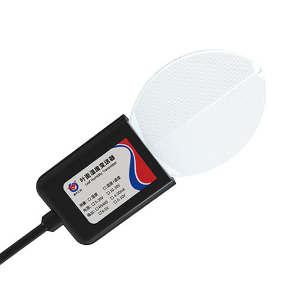
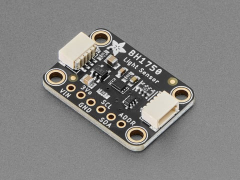
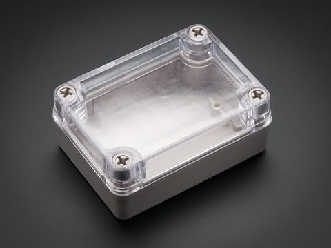

# AI-Powered Plant Health Monitoring and Disease Detection Using IoT & WSN

System: PlantGuard

Simran Batwal | Roll number: 28452500003

M.Tech | Computer Science | 3rd Semester

Guru Nanak Dev University, Amritsar

Guide: Dr. Anil Kumar

8 September 2026 | Initial-stage proposal

# Request for project components

To: Dr. Anil Kumar, Project Guide

Computer Science, Guru Nanak Dev University, Amritsar

**Subject: Request for financial support for PlantGuard project components**

Respected Sir,

I am Simran Batwal, roll number 28452500003, a student of M.Tech, Computer Science, 3rd Semester. I request financial support for the components required for my project, **AI-Powered Plant Health Monitoring and Disease Detection Using IoT & WSN**. The system name is **PlantGuard**.

I plan to build a college prototype with two tomato plants, two ESP32 wireless sensor nodes, environmental sensors and a camera. A laptop-based application will receive the readings, process leaf images and display the results. I will begin implementation after discussing the scope with you.

The estimated cost of physical components and consumables is **INR 18,150**. I have included a 20% reserve of **INR 3,630** for price changes and necessary charges. The total amount requested for consideration is **INR 21,780**.

A laptop is not included in this request. I will check the availability of the camera, network equipment and laboratory tools before purchase. The camera allowance and optional light sensors can be removed if they are not needed. Cloud services and a separate AI processing box are not part of this proposal.

I have attached the item-wise estimate. I will obtain quotations for the selected models and follow the department's purchase and reimbursement procedure. Kindly review the requirement and advise on the components and funding support that can be approved.

Yours faithfully,

**Simran Batwal**

Roll number: 28452500003

Date: ____________________    Signature: ____________________

# Itemised estimate 1: electronics

All amounts are in INR. The quantities cover two nodes. These are initial estimates; I will confirm the exact models and prices through quotations before purchase.

| Item | Qty | Unit INR | Total INR |
|---|---:|---:|---:|
| ESP32 DevKitC V4 / WROOM-32E, matched pair (Core) | 2 | 600 | 1,200 |
| Capacitive soil-moisture probe, SEN0193 class (Core) | 2 | 350 | 700 |
| SHT31 temperature / humidity breakout (Core) | 2 | 450 | 900 |
| Artificial leaf-wetness plate, RS485 variant (Quote required) | 2 | 3,500 | 7,000 |
| 3.3 V MAX3485 RS485 interface module (Core) | 2 | 300 | 600 |
| BH1750 lux sensor (Optional) | 2 | 150 | 300 |
| Breadboard / prototype base (Core) | 2 | 200 | 400 |
| Mixed jumpers and insulated hookup wire, lot (Core) | 1 | 400 | 400 |
| USB data cable matched to purchased board (Core) | 2 | 150 | 300 |
| Regulated supplies and distribution, lot (Core) | 1 | 600 | 600 |

## Points I will check before purchase
I will select two matching ESP32 boards and data-capable USB cables. I will check that the sensor breakout boards and communication interfaces work with the selected 3.3 V logic.

The leaf-wetness sensor is the largest part of the estimate. I will obtain a quotation for the exact RS485 Modbus model and check its supply voltage, cable, output units and register details. The INR 3,500 unit cost is an allowance for planning.

The power allowance will cover the regulated supplies required by the selected parts. I will check the sensor supply and ESP32 signal connections separately before assembly.

BH1750 is optional. Removing both light sensors would reduce the parts subtotal by INR 300. The first prototype can work without light measurement.

# Itemised estimate 2: setup and total

| Item | Qty | Unit INR | Total INR |
|---|---:|---:|---:|
| Gasketed prototype enclosure (Core) | 2 | 350 | 700 |
| Glands, terminals, fuse and standoffs, lot (Core) | 1 | 500 | 500 |
| USB webcam with usable close focus (If needed) | 1 | 1,500 | 1,500 |
| Camera / sensor stands and air shields, lot (Core) | 1 | 800 | 800 |
| Tomato seedlings, similar compact cultivar (Core) | 2 | 150 | 300 |
| 10-15 L pot with drainage tray (Core) | 2 | 300 | 600 |
| Consistent potting medium, lot (Core) | 1 | 500 | 500 |
| Plant stakes, labels and soft ties, lot (Core) | 1 | 250 | 250 |
| Spare connectors and assembly consumables (Core) | 1 | 600 | 600 |

**Subtotal INR 18,150 + 20% contingency INR 3,630 = ceiling INR 21,780.**

I have included a 20% reserve for price changes, tax, delivery and small necessary accessories where these are not already included. I will record the actual amount paid against each invoice and avoid adding the same charge twice.

If the final quotations exceed the approved amount, I will discuss a revised setup or budget before purchase.

# Cost-saving options

| Setup | Subtotal | 20% reserve | Proposed total |
| Full proposed setup | 18,150 | 3,630 | 21,780 |
| Use an available camera | 16,650 | 3,330 | 19,980 |
| Remove optional BH1750 pair | 17,850 | 3,570 | 21,420 |
| Available camera, no BH1750 pair | 16,350 | 3,270 | 19,620 |

## How I plan to reduce the cost
I will first check whether a phone or camera can capture clear close-up leaf images. If it is suitable, I will not need the webcam allowance. I will also check the availability of laboratory tools and network equipment.

I can begin assembly with the controller, soil sensor and air sensor. After checking the first readings and the wetness-sensor quotation, I can add the wetness plate and its interface. The completed wireless setup will still use two nodes.

The optional BH1750 pair can be kept for later. If any main sensor has to be removed because of cost or availability, I will discuss the change with my guide and update the experiment plan.

## Checking supplier offers
I will compare offers for the same technical model, including cable, supply requirements, tax, delivery and warranty. I will record the quoted and paid amounts separately. Supplier selection will follow the department's procedure.

# Component photographs and setup

[Product-family source](https://docs.espressif.com/projects/esp-idf/en/v4.3.6/esp32/hw-reference/esp32/get-started-devkitc.html)

[Product-family source](https://www.dfrobot.com/product-1385.html)

[Product-family source](https://www.adafruit.com/product/2857)

[Product-family source](https://www.renkeer.com/product/leaf-wetness-sensor/)

[Product-family source](https://www.adafruit.com/product/4681)

[Product-family source](https://www.adafruit.com/product/903)

These photographs show the required types of components. I will confirm the actual model, price and electrical details before purchase. The product-source links are provided below each image.

## Plants and camera
I will use two labelled pots with drainage trays, two similar tomato seedlings and a common batch of potting medium. The plant stakes and soft ties will provide support. A stable camera stand will help me capture repeatable close-up images.

## Other equipment
A laptop will run the application. I will check whether the phone/camera, Wi-Fi access point, multimeter, soldering station and basic hand tools are available in the laboratory or can be arranged separately. They are not additional purchases in this estimate.

The enclosures and supports will protect the prototype from loose wiring and accidental splashes. Air-sensor shields and wetness-plate supports are included in the setup allowance.

# Purchase process and approval

## Proposed purchase process
1. I will discuss the component list and final setup with my guide.
2. I will check the laboratory inventory and collect the quotations required by the department.
3. I will follow the approved purchase, advance or reimbursement procedure.
4. On receiving the parts, I will check the model, quantity, condition, supply requirements and operation.
5. I will keep invoices and a parts record. Reusable items will be recorded according to departmental rules.
6. At the review, I will show the working setup, readings and a statement of the actual expenditure.

## Approval details
| Field | Entry |
| Proposed total | INR 21,780 |
| Approved amount / changes | ______________________________ |
| Funding source / reference | ______________________________ |
| Purchase route | Department purchase / advance / reimbursement |
| Guide's recommendation | ______________________________ |
| Approving authority | ______________________________ |
| Signature and date | ______________________________ |

## Use of the components
The components will support sensor calibration, wireless communication and the connection between leaf images and sensor readings. I will use them to build and test the PlantGuard college prototype. Reusable items can support further laboratory work according to departmental rules.

Simran Batwal | Roll number: 28452500003

