# PlantGuard Final Master Plan

## College prototype and VPS based market product

**Official M.Tech title**
AI-Powered Smart Plant Health Monitoring and Disease Detection Using IoT & WSN

PlantGuard ko pehle measurable research prototype banana hai: two wireless sensor nodes, camera, laptop processing, multi-crop vision experiments aur honest evaluation. Uske baad wahi intelligence VPS par deploy hogi, field mein weatherproof Sensor Boxes aur cameras rahenge.

Yeh implementation report hardware selection, item pictures, wiring, data, AI, treatment intelligence, software, testing, budget, 180-day schedule aur commercial pilot ko ek jagah define karti hai.

**Plan baseline** 8 September 2026 • Version 1.0
**Working assumptions** India-focused procurement and treatment sources; costs in INR; existing laptop; one student working about 20-25 focused hours per week with guide and agricultural expert access.
**Calendar** Day 1 is the actual project start. Dates in this report illustrate a start on 8 September 2026. Hardware delivery, field access and disease observations can extend validation.

This is a development plan. Accuracy, disease lead time, yield benefits, battery life and commercial readiness must be established by experiments.

# 01 Decisions to follow

**Market AI will run on the VPS.** Sensor Box mein ESP32, sensor interfaces, power aur communication electronics honge. Optional communication gateway sirf readings forward/buffer karega. No dedicated field AI processing box is required.

**College AI will run on the laptop.** USB camera ya existing phone se images; two ESP32 nodes se Wi-Fi data; local backend, database and dashboard. Internet is optional after software/models are installed.

|Decision|Final choice|
| --- | --- |
|System identity|PlantGuard; tagline Plant Health Intelligence|
|Physical college crop|Two similar tomato plants, two pots and two zones|
|Vision research scope|Tomato, potato, maize, apple, grape, pepper and rice, subject to usable labels|
|Controller|Two identical ESP32-DevKitC V4 boards with ESP32-WROOM-32E|
|Core sensing|Capacitive soil moisture, SHT31 air temperature/RH, artificial leaf-wetness plate|
|Useful optional sensor|BH1750 light sensor on both nodes|
|WSN|Two sensor nodes communicating over Wi-Fi to the same access point/laptop|
|AI comparison|MobileNetV3, ResNet50, EfficientNet-B0, ViT; select using measured results|
|Market compute|Linux VPS; cloud GPU only if profiling justifies it|
|Primary research question|Can evidence quality and adaptive re-scanning improve reliability at a measured sensing cost?|

The supplied latest plan remains the design baseline. Component prices and feasibility decisions are planning estimates, not purchasing commitments. The product drawings are concepts; use the specification and supplier documentation when ordering.

**First purchase decision:** build one node, prove its sensors and power, then duplicate it. Order long-lead leaf-wetness parts early. Do not buy seven live crop setups to demonstrate a seven-crop image model.

# 02 College and market scope

|Capability|College completion target|Market development target|
| --- | --- | --- |
|Vision diagnosis|Compare four models; evaluate seven-crop image taxonomy|Release only crop/disease combinations validated for customer conditions|
|Physical sensing|Two identical nodes, two tomato pots|Replicated zone nodes; site survey determines density|
|Temporal risk|Rules baseline; RF/XGBoost comparison if event labels exist|Prospective crop-specific risk model after seasonal validation|
|Fusion|Aligned local tomato data; image-only fallback|Production quality gates and calibrated multimodal evidence|
|Unknown inputs|Reject unsupported crop, non-leaf and uncertain cases|Monitored abstention and expert escalation|
|Severity|Lesion area on a limited mask-labelled subset|Crop-specific severity rubric and repeatability checks|
|Treatment|Versioned, reviewed management knowledge base|Region/formulation-specific sources with review workflow|
|Continual learning|One controlled model-update experiment|Verified labels, regression gates, rollback and audit|
|Interface|React web UI plus teacher processing view|Responsive web/PWA first; Android after usage evidence|

Three completion levels keep the project practical. **Core** is a working two-node system, four vision comparisons, unknown rejection, basic aligned fusion, source-based treatment retrieval and full evaluation. **Research extensions** are learned forecasting, segmentation, adaptive evidence acquisition and a continual-learning experiment. These remain in the roadmap, but their claims depend on data. **Commercial work** adds durable hardware, multi-tenant service, support and prospective trials.

Do not label an untrained module as AI. A working environmental rule score is an acceptable baseline if its UI says so. A risk forecast requires future outcome labels, an explicit horizon and a held-out evaluation.

No compulsory drones, robotic sprayer, autonomous pesticide application, hyperspectral camera, Jetson or blockchain. VOC, pH, EC, soil temperature, NPK, rainfall, wind and CO2 are future experiments with separate calibration and justification.

# 03 Product family concept

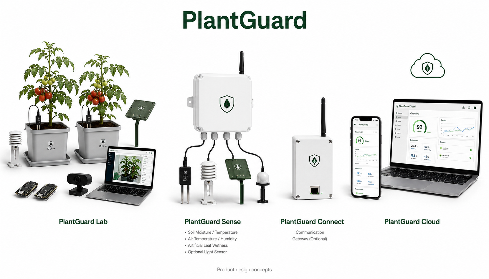

|Product concept|What it contains|Where intelligence runs|
| --- | --- | --- |
|PlantGuard Lab|Two development nodes, pots, camera and laptop UI|Laptop|
|PlantGuard Sense|Weatherproof zone sensor node with external probes|VPS; node only collects and transmits|
|PlantGuard Connect|Optional LoRaWAN gateway or network bridge|No disease AI on gateway|
|PlantGuard Cloud|Accounts, AI inference, history, recommendations and review tools|VPS|

PlantGuard Scan is the camera workflow inside the web/mobile product. A separate handheld camera product is unnecessary initially; a phone already provides a practical manual scan.

**Illustration note:** this is an AI-generated industrial design concept. It is not an assembly drawing or proof of performance. Probe shapes, displayed numbers and sensor temperature options are illustrative. The selected college soil probe measures relative moisture; soil temperature is optional.

**Brand use:** green shield + leaf + connected nodes represent protection, plant health and sensing. Use the saved logo with clear space around it and a white background. Keep PlantGuard spelling consistent. Do not add a registered trademark symbol before registration. Check name availability before commercial packaging.

# 04 College system architecture

Nodes A and B → local Wi-Fi access point → laptop broker/database → laptop AI and UI. Camera → laptop.

Node A and Node B each read their own sensors. Both join the same Wi-Fi access point, and publish measurements to a broker or API running on the laptop. An existing router can form a local network without an internet uplink. Test firewall rules before the demo.

The camera connects directly to the laptop by USB, or a phone submits a captured photo. Camera images do not pass through ESP32. The backend associates each scan with the selected crop, zone and capture time before looking up its sensor history.

The laptop hosts FastAPI, vision inference, environmental rules/models, confidence handling, treatment retrieval, PostgreSQL or initial SQLite, image files and the React interface. For a simple early build use SQLite; move to PostgreSQL before deployment/multi-user work.

Start with USB serial on Day 7-10 to debug each board. By Day 21 the final demonstration must use **wireless readings from both nodes**. USB cables may supply power while Wi-Fi carries the data. Power by USB does not invalidate a wireless sensing network.

**Fallback modes:** sensors missing means image-only diagnosis with a visible data-gap message; camera missing means sensor monitoring only. An old sensor record must never appear as a new live measurement. Save a labelled replay for presentation recovery, and show when replay mode is active.

Architecture selection uses ESP32 capabilities documented by Espressif [S01]. Pin assignments later in this report apply to the selected classic ESP32 board only.

# 05 VPS market architecture

Sensor Boxes → Wi-Fi router or optional LoRaWAN gateway → internet → VPS AI/database/API → web/mobile. Phone/fixed-camera images → HTTPS → VPS.

**Route A for the first pilot:** Sensor Boxes use site Wi-Fi. The farm router provides internet through broadband or 4G. Nodes send small telemetry messages by MQTT over TLS. A phone or fixed camera uploads compressed snapshots separately over HTTPS.

**Route B for a large or poorly covered site:** compatible LoRaWAN nodes send telemetry to an appropriate gateway; the gateway forwards to the network server and VPS. LoRaWAN is not the same as raw LoRa point-to-point. Select the complete stack together. Do not send leaf photos through the low-rate sensor radio link.

VPS services comprise authentication, farm/zone registry, MQTT ingestion, AI job queue, vision/risk/fusion services, treatment knowledge base, PostgreSQL, object storage, notifications, audit logs and monitoring. Use a CPU instance for the initial measured workload; train models separately and deploy versioned inference artefacts.

During an internet outage, nodes/gateway keep a bounded buffer where hardware supports it; phone scans can queue for later upload. Show the last contact time. **New cloud diagnoses are unavailable until the connection returns.** Buffering and store-and-forward do not require an AI processing box.

Use unique device credentials and topic restrictions per farm. Images use tenant-scoped object keys and short-lived signed access. Keep database access private. Backups must be restorable, not just reported as successful.

Gateway location, radio band, antenna, transmit power and coverage are finalised after a site survey and applicable local radio checks [S17]. There is no universal number of plants per node or guaranteed distance.

# 06 Which controller to buy

[Manufacturer reference](https://docs.espressif.com/projects/esp-idf/en/v4.3.6/esp32/hw-reference/esp32/get-started-devkitc.html)

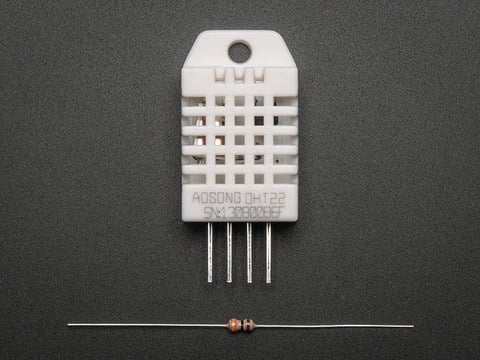

[Manufacturer reference](https://www.adafruit.com/product/385)

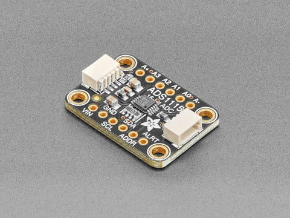

[Manufacturer reference](https://www.adafruit.com/product/1085)

|Option|Reason to consider|PlantGuard decision|
| --- | --- | --- |
|ESP32-DevKitC V4 WROOM-32E|Wi-Fi, GPIO, ADC and I2C; Arduino framework support|Recommended college board; buy two identical units|
|Generic ESP32 DevKit V1|Often cheaper; pin arrangement varies|Acceptable only after matching schematic, USB chip and pinout|
|ESP32-S3 development board|More capable variants; different pins and memory options|Future hardware revision; not a drop-in wiring replacement|
|Arduino Uno R3 or classic Nano|Useful teaching boards; classic versions lack built-in Wi-Fi|Do not purchase for this baseline|
|Arduino Nano ESP32|Different Arduino board using ESP32 family|Valid alternative, but its pin mapping must be redesigned|
|Raspberry Pi or Jetson|Linux/edge compute|Not required for either locked architecture|

Arduino is also the name of a programming framework. **ESP32 par Arduino framework use karna aur Arduino Uno board lena alag baatein hain.** We will write C++ firmware with the Arduino framework, and can adopt ESP-IDF later.

Use a data-capable USB cable and the driver appropriate to the board USB bridge. Before ordering, ask for the exact module name, board pin count, connector type, schematic and warranty. Avoid mixing an S3 board with classic ESP32 wiring.

DHT22, shown as an alternative, is acceptable for a constrained demo, but choose SHT31 for the main build. ADS1115 is an optional external ADC when analogue repeatability needs improvement; it is not needed simply to read a digital I2C SHT31. [S01, S03, S07, S08]

# 07 Core sensor picture guide

[Manufacturer reference](https://www.dfrobot.com/product-1385.html)

[Manufacturer reference](https://www.adafruit.com/product/2857)

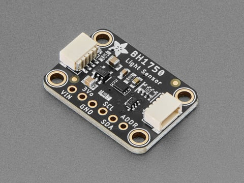

[Manufacturer reference](https://www.adafruit.com/product/4681)

**Soil moisture — capacitive analogue probe.** Preferred documented reference is DFRobot SEN0193; an equivalent capacitive v1.2 module is the low-cost choice only after checking its output voltage and repeatability. Insert the sensing part into the representative root zone, not against the pot wall; keep the electronics and connector out of wet soil. It measures a proxy that changes with water, substrate, salts and placement. It does not identify a disease or provide true volumetric water content without suitable calibration. [S02]

**Temperature and humidity — SHT31-D I2C module.** Buy two matching breakouts with documented 3.3 V operation. Put the sensor near the canopy inside a ventilated radiation shield, away from board heat and direct splashes. Air humidity is not leaf wetness. Bare SHT31 boards cannot be sealed inside a box and still measure canopy air correctly. SHT30 is the fallback within the same family; DHT22 is a budget downgrade. [S03]

**Light — BH1750 I2C module.** Optional but useful for recording illumination and understanding image variability. It measures lux; it is not a calibrated PAR/PPFD instrument and must not be relabelled as photosynthetically active radiation. Install in a representative unobstructed position and evaluate any protective cover. [S04]

Photographs show manufacturer reference products. Indian generic boards can look different and have different regulators, connectors and pull-ups. Match the specification, not only the photograph. Photos retain their manufacturers' rights and are included here for component identification; they do not imply endorsement.

# 08 Leaf wetness and industrial probes

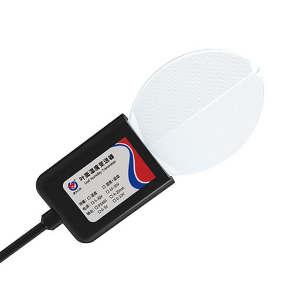

[Manufacturer reference](https://www.renkeer.com/product/leaf-wetness-sensor/)

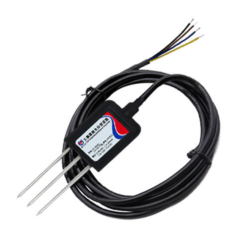

[Manufacturer reference](https://www.renkeer.com/product/soil-moisture-sensor/)

**Recommended research-budget wetness option:** Renke RS-WS-*-YM-1-T, explicitly ordered in its **RS485 Modbus variant**, one per zone. The asterisk represents an output/configuration option; obtain a written quote with the complete order code, Modbus register map and cable definition before buying. Its manufacturer lists 5-30 V supply for RS485. Our lab design uses a regulated 5 V rail if the supplied variant confirms this specification. [S05]

Mount the artificial leaf plate on an independent stake in the canopy, exposed to representative wetting and drying. Record angle, height and orientation. Follow the selected manufacturer's mounting instructions. Do not attach a plate to every real leaf, coat the sensing face or place it inside the sealed box.

Store raw plate output, calibrated wet/dry state and **leaf-wetness duration in minutes**. Vendor percentages must not be interpreted as a botanical percentage of wet leaf area. Wetness supports environmental risk analysis; it does not prove infection.

**Higher-end reference:** METER PHYTOS 31 dielectric wetness sensor with documented excitation/output requirements [S06]. It is a quote-based upgrade, potentially beyond the student budget. Its analogue interface is different from the selected RS485 sensor.

**Cheap rain boards:** exposed grid water/rain modules can demonstrate wet/dry response but are corrosion-prone and physically different. Call them a proxy in the UI and thesis. They cannot justify validated leaf-wetness duration or disease-forecast claims without a reference comparison.

**Market soil probe:** a documented industrial RS485 moisture/temperature probe, such as the Renke product family shown [S09]. Require soil-specific calibration evidence, accuracy conditions, power specification, ingress rating and replaceable connector. Do not start by buying an unvalidated 7-in-1 NPK/pH probe.

# 09 Assembly essentials picture guide

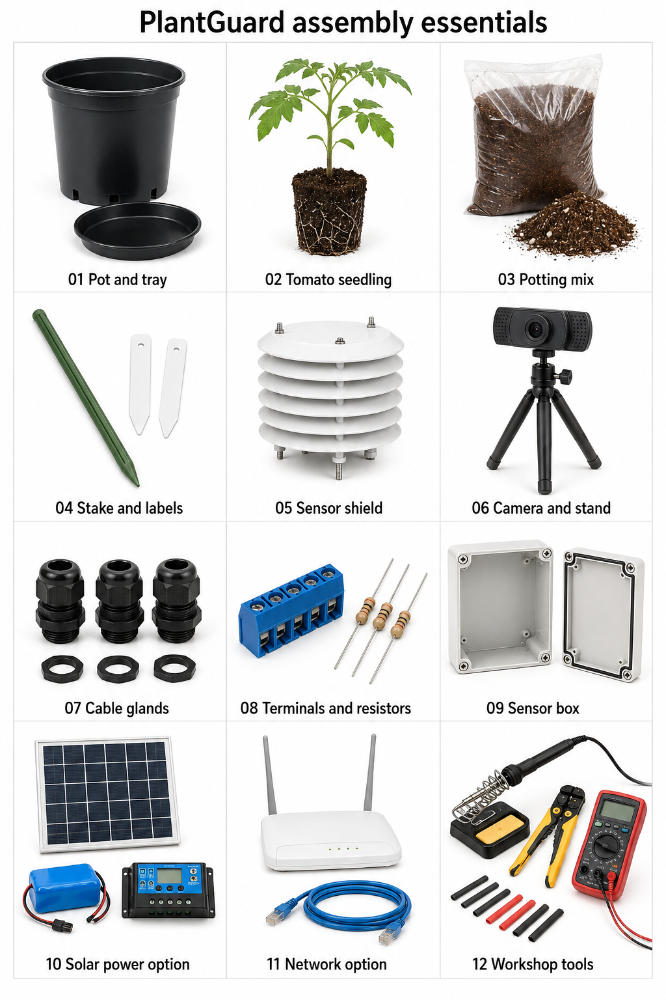

Items 01-12 are AI-generated generic identification illustrations. Exact sizes, chemistry, voltage and ratings must follow the written specifications. The solar panel/battery picture represents an optional subsystem, not a ready-to-wire kit.

# 10 Pots plants and mounting

**Pots and trays, picture 01:** use two identical opaque plastic pots of roughly 10-15 litres with drainage holes and separate trays. For the short classroom study, buy compact/determinate tomato seedlings suited to containers. Full-season or vigorous varieties may need larger containers; get the nursery/agronomist to confirm. Terracotta is usable but changes evaporation and adds weight. Fabric bags drain well but make probe placement less repeatable. Consistent plastic pots are easier to compare.

**Plants and medium, pictures 02-03:** choose two healthy seedlings of the same variety and similar age. Record variety, transplant date, substrate batch and approximate fill volume. Use a suitable nursery potting mix; avoid changing the recipe halfway through calibration. Two pots demonstrate two network zones; they do not constitute a statistically strong disease trial.

**Stakes and labels, picture 04:** provide plant support plus separate sensor stakes. Label every pot, node, probe and cable: farm DEMO, zone A/B, plant A01/B01. Labels must match database IDs. Fit strain relief so moving the pot cannot pull out a sensor pin.

**Air shield, picture 05:** use a ventilated white radiation shield above soil near the crop canopy. Mount independently from the warm electronics box. **Camera stand, picture 06:** use a tripod/clamp with adjustable focus distance and a consistent background card; a white diffuse light can help indoors.

**Small parts, pictures 07-09:** cable glands sized to cable diameter, gasketed box, standoffs, screw terminals, zip ties, hook-up wire, labels, heat-shrink, spare connectors, appropriate fuse and resistors if the interface requires them. Drill glands downward where practical and create drip loops.

Keep watering controlled by the plant's needs; record watering time and quantity. Do not deliberately infect plants for a classroom demo. Use lawful reference images, naturally observed cases or an institutionally supervised plant-pathology study for disease evidence.

# 11 Power tools and optional communication

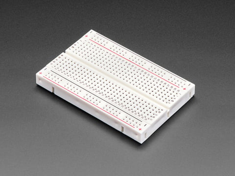

[Manufacturer reference](https://www.adafruit.com/product/64)

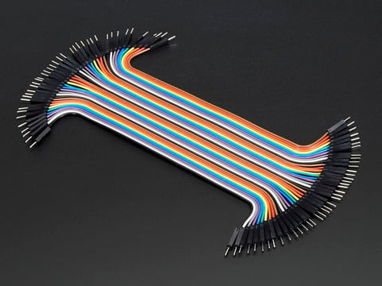

[Manufacturer reference](https://www.adafruit.com/product/758)

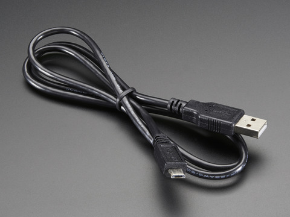

[Manufacturer reference](https://www.adafruit.com/product/592)

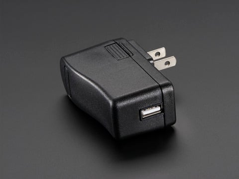

[Manufacturer reference](https://www.adafruit.com/product/1994)

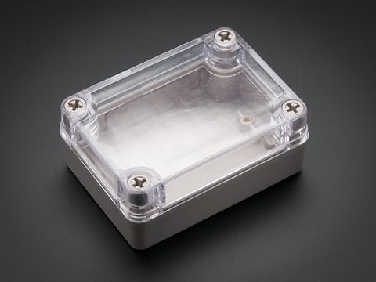

[Manufacturer reference](https://www.adafruit.com/product/903)

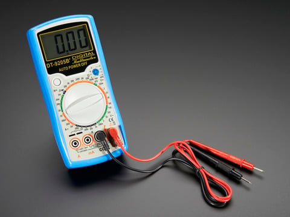

[Manufacturer reference](https://www.adafruit.com/product/2034)

**Bench wiring:** two breadboards or suitable prototyping bases, male/male and male/female jumpers, a data USB cable per board and a common ground within each node. Final demonstration should use mechanically secure joints; loose jumper wires are a development tool.

**Power:** select a regulated 5 V supply with sufficient measured peak-current capacity and locally appropriate safety approval. For the recommended lab node, power ESP32 through USB and the external 5 V wetness probe from a suitable protected rail; join signal ground as required. Do not join two active 5 V sources. Espressif specifies mutually exclusive power-input options [S01]. Keep exposed mains away from pots.

**RS485 interface:** use a documented 3.3 V MAX3485-based TTL-to-RS485 module, one per node [S10]. Classic 5 V MAX485 modules can expose ESP32 pins to unsafe logic levels. Obtain the module schematic. For field deployment use an isolated, protected industrial interface and qualified cabling design.

**Workshop tools:** borrow a multimeter and soldering station; add wire stripper, heat-shrink, continuity checks and a simple screw kit. Buy one spare controller and spare cheap probes only after the first build works.

**Solar and battery, picture 10:** defer until measured energy demand exists. Use a protected battery with a charger matching its chemistry; do not assume a generic charger suits LiFePO4. **Networking, picture 11:** reuse a local router for college. Market LoRaWAN candidates include a region-appropriate RAK3172-based node design and compatible multi-channel gateway; hardware selection follows the coverage survey, not a promised range.

# 12 Proposed wiring and electrical checks

|Selected classic ESP32 connection|Destination|Check before power|
| --- | --- | --- |
|3V3 and GND|SHT31 supply and ground|All I2C pull-ups go to 3.3 V|
|GPIO21 SDA and GPIO22 SCL|SHT31 and optional BH1750 I2C bus|SHT31 usually 0x44; BH1750 usually 0x23; scan actual addresses|
|3V3 and GND|Documented capacitive soil module supply|Confirm sensor supports 3.3 V|
|GPIO34 ADC1 input|Soil sensor analogue output|Measure output; never exceed ESP32 input limits|
|GPIO17 TX2|RS485 module DI|3.3 V TTL interface|
|GPIO16 RX2|RS485 module RO|3.3 V receive level|
|GPIO25|RS485 DE and active-low RE control|Tie/control according to module schematic|
|3V3 and GND|MAX3485 module supply|Do not substitute a 5 V MAX485 wiring plan|
|RS485 A and B|Wetness sensor A and B|Use supplied pin map; vendors may use different A/B naming|
|External regulated 5 V and ground|Selected 5-30 V wetness sensor|Confirm exact RS485 variant and share/reference ground correctly|

This is a **proposed wiring map**, not a tested circuit. For WROOM-32E, GPIO16/17 can be assigned to UART. Other ESP32 modules may reserve these pins. Use ADC1 for classic ESP32 analogue sensing while Wi-Fi is active. GPIO34 is input-only. Check the selected board documentation [S01].

Use short I2C/analogue cables on the bench. Long outdoor cables should use suitable differential interfaces and surge protection. RS485 is a daisy-chain bus with end termination where required by cable length/data rate; do not add termination at every sensor. Confirm baud rate, parity, address and registers rather than inventing them.

Bring up one device at a time: inspect unpowered wiring; verify supply polarity and voltage; connect board; read SHT31; read soil; read wetness; add light; combine; then switch on Wi-Fi. Photograph the actual final wiring and place it in the thesis after construction.

# 13 Calibration and sensor maintenance

**Soil:** record raw values for a repeatable dry substrate reference and watered/drained reference in the same medium. Repeat readings after settling, reinstall the probe and assess variation. A simple relative index is clamp[100 x (dry_raw - raw)/(dry_raw - wet_raw), 0, 100] when signal decreases with wetness. Reverse the mapping if needed. Label it **relative moisture index**, not measured volumetric water content. For VWC, perform an appropriate gravimetric/reference calibration.

**Air temperature/RH:** co-locate both sensors and a reference instrument in shade. Log differences at stable conditions; investigate bias, heating, wet contamination and slow response. A consistency check does not create a traceable calibration certificate. Record reference model, conditions and date.

**Leaf wetness:** perform repeat dry, wetted and drying cycles with manual wet/dry observations or a reference device. Select wet/dry thresholds on calibration data, use hysteresis to prevent chattering, and validate separately. Record duration from sample intervals, including unknown periods during gaps. Do not count a missing interval as dry.

**Light:** compare placement and repeatability under stable illumination. Lux saturation or a wet/dirty cover is a quality flag. It cannot establish crop-specific light dose without appropriate instrumentation.

**Health rules:** flag absent readings, invalid units, out-of-range values, implausible rates of change, prolonged identical digital values and disagreement with a co-located reference. A constant soil reading can be real; detect a fault using several checks rather than declaring every flat line faulty.

**Schedule:** inspect cables and power daily during bring-up; verify clocks and missing records daily; clean optics/plates gently weekly or as instructed; inspect enclosures after rain; recalibrate after replacing sensors or changing soil. Store calibration version and quality flag with every reading.

# 14 WSN and sampling plan

|Setting|Initial college configuration|How to validate|
| --- | --- | --- |
|Topology|Two Wi-Fi nodes to common AP and laptop broker|Both node IDs visible with independent readings|
|Normal sampling|Read sensors every 60 seconds|Enough temporal resolution for wetness transitions|
|Normal upload|Batch up to 5 one-minute readings every 5 minutes|Retain original measurement times|
|Demo view|Temporary 5-10 second updates|Mark demo mode; exclude from routine energy claims|
|Adaptive episode|Temporarily sample every 15 seconds for up to 10 minutes|Respect sensor response time and power budget|
|Transport|MQTT QoS 1 or acknowledged HTTP ingest|Deduplicate by node ID and sequence number|
|Offline strategy|Bounded persistent queue if flash design supports it|Power-cycle and reconnect without silent loss|

QoS 1 can deliver duplicates. Keep node_id, boot_id and sequence number so the server recognises repeats. Use measurement_time and received_time separately. Sync the clock at boot and periodically; record uptime/clock uncertainty if time sync fails. Buffer historical data with original timestamps.

Measure **packet delivery ratio = unique received packets / generated packets** over a defined run, not packets received divided by retries. Report latency median and p95, reconnect time, packet loss, duplicates, range conditions, sampling frequency and transmissions per hour. Measure energy with current logging if making energy-saving claims.

Run at least one long observation across representative placement and an outage/reconnect test. Start with a local target of 95% unique packet delivery and under 5 seconds p95 ingest latency on the chosen test network; these are project acceptance targets, not proven values or market service guarantees.

ESP-NOW can be a later alternate experiment. It normally needs an additional receiver/bridge into the laptop; do not quietly count two sensor nodes plus an unbudgeted third board as a two-board design.

# 15 Camera and scan protocol

**College choice:** existing phone camera or a USB UVC webcam with usable close focus. Budget for a 1080p-class camera with adjustable focus if available; resolution alone does not guarantee visible lesions. Before buying, test a leaf at the intended distance and inspect a saved still at full size. A laptop webcam can be a fallback if it resolves the features.

**Capture procedure:** select crop and zone; show the plant ID; capture the whole leaf and a closer view of the symptom under diffuse light; avoid motion blur, heavy shadows and filters; store original capture time. Keep images from the same leaf/plant session together in the dataset split. Never use the screenshot of an earlier model result as a new training photograph.

**Quality gate:** reject images that are too blurred, dark, overexposed, tiny or unrelated. Ask for a better view when a symptom is partially hidden. Crop confirmation by the user is a defensible first version; automatic crop recognition is a separate model with its own errors.

**Fixed field camera:** an optional weatherproof RGB camera with suitable lens, focus, installation and network support. Start with scheduled snapshots; changing the lens, distance or lighting changes the diagnostic task. A wide greenhouse overview cannot diagnose every leaf. Keep manual phone scanning even with fixed cameras.

Image traffic uses USB/Wi-Fi/Ethernet/HTTPS, separate from low-rate LoRaWAN telemetry. Protect camera credentials and obtain farm consent before recording people or neighbouring property. Store only the image detail and duration needed for the agreed service.

There is no plan for a special PlantGuard handheld camera at launch. First prove that existing phone capture gives reproducible quality and that customers can complete the scan workflow.

# 16 Datasets and crop coverage

|Dataset|Purpose|Important boundary|
| --- | --- | --- |
|PlantVillage|Controlled-background training baseline; commonly reported 54,306 images and 38 crop-health classes|Record actual downloaded version/counts and licence; controlled backgrounds differ from farms [S11]|
|PlantDoc|More cluttered field/web imagery for external evaluation; repository describes 2,598 images|Check taxonomy, labels, duplicates and CC BY 4.0 obligations [S12]|
|Paddy Doctor|Rice disease/pest images and metadata; authors describe 16,225 cleaned images|Archive contents/class list can differ from competition subsets; audit exact release and media rights [S13]|
|PlantWild and v2|In-the-wild robustness research; v2 lists 115 classes|CC BY-NC-ND 4.0; no assumed commercial permission; review permitted research use [S14]|
|PlantDiseaseCL|Optional continual-learning benchmark|Inspect original release, splits and licence before use|
|PlantGuard field data|Own timestamped photos, sensor history and verified outcomes|Essential for aligned multimodal evaluation; explicit consent and rights|

Initial image crop taxonomy is tomato, potato, maize/corn, apple, grape, pepper and rice. Build a table of actual disease labels available for each crop; include healthy only where labelled healthy examples exist. Rice/paddy and corn/maize names must map to one canonical identifier each.

Use PlantVillage as a baseline, not as proof of market accuracy. Do not promise that all pests, nutrient deficiencies, fruit disorders and stem diseases are supported. Add them as labelled classes only when enough verified data exists; otherwise use unknown/review.

Download datasets into versioned folders, retain checksums and source URLs, and record commercial eligibility separately from research use. A repository code licence alone does not settle every photograph's commercial rights. Exclude restricted or unresolved media from a commercial training release until rights are established.

# 17 Cleaning labels and synchronized field data

**Data cleaning:** decode every image, remove corrupt files and exact/near duplicates, reconcile synonymous labels, inspect suspicious samples and record removal reasons. Keep original files immutable; derived images and augmentations have their own version. Apply augmentation to training only.

**Splits:** group by plant, capture session, source and farm before splitting. An illustrative image split is 70% train, 15% validation and 15% locked test, adjusted to class support. Repeated photos of one leaf belong to one split. Field risk evaluation must hold out later periods/farms and prevent overlapping temporal windows from leaking across boundaries. Keep the test set sealed until model choices are frozen.

|Record|Minimum required fields|
| --- | --- |
|Sensor|farm_id, zone_id, node_id, boot_id, sequence, measured_at, received_at, values, units, quality, calibration_version|
|Image|image_id, farm_id, zone_id, plant_id, crop_id, captured_at, device, consent, quality_status, file_hash|
|Expert label|condition_id, label_status, label_method, annotator, date, severity rubric and optional mask|
|Prediction|image_id, evidence window, model versions, calibrated scores, abstention reason, processing time|
|Follow-up|observed onset/time interval, treatment/source if used, outcome date, expert confirmation|

For a scan at time t, use only sensor history available up to t in that zone. Start with a 24-hour lookback and test 6/12/24/48-hour alternatives if justified. Reject a history with excessive missingness; record coverage. Never pair public leaf photos with invented local readings and call this genuine multimodal training.

Start logging by Day 14. Aim to collect continuously over 60-90 days and several plants/sessions, using expert-verified cases where accessible. Two healthy pots yield a useful engineering dataset, not the disease events needed for reliable forecasting. Assess event coverage with the guide before fitting a temporal disease model.

# 18 Vision experiments and model selection

|Model|Role|Starting comparison configuration|
| --- | --- | --- |
|MobileNetV3 Large|Lightweight baseline|Transfer learning; native pretrained preprocessing|
|ResNet50|Established convolutional reference|Same taxonomy/splits and equivalent tuning effort|
|EfficientNet B0|Accuracy versus compute comparison|B2 only if budget allows an additional experiment|
|ViT B16 or smaller justified ViT|Transformer comparison|Pretrained initialization; disclose resolution and parameter count|

Use Python, PyTorch/torchvision or timm, OpenCV and a reproducible environment. Pin working versions during setup and save the environment file; avoid promising a specific latest version months in advance. Train a small pipeline smoke test before a full dataset run.

Use the same split and label taxonomy for all models. Keep augmentation policy and tuning budget comparable; each architecture may need its own optimiser settings and native preprocessing. Record random seed, class balance strategy, early-stopping rule, epochs, best checkpoint, hardware and training time. Use multiple seeds where compute allows and report variation.

Report accuracy, macro precision/recall/F1, per-class recall/F1, confusion matrix, parameter count, saved model size, training time and inference latency. Measure latency after warm-up at batch size one on the actual laptop/VPS, including p50 and p95 and whether preprocessing is included. Compare calibration error and reliability diagrams if showing probabilities.

Select the model using validation results and deployment limits. Evaluate once on the locked test set and on separate field data. Do not predetermine a winner or present generated dashboard percentages as measured results.

If GPU access is limited, start with a frozen pretrained backbone and a classifier head, then fine-tune. Complete all four meaningful baselines at feasible scale rather than spending the semester tuning only one model. The selected production model may differ from the highest laboratory accuracy model.

# 19 Environmental risk and fusion

**Current visual diagnosis** asks what condition is visible now. **Future disease risk** asks whether a defined event may occur within a specified future period. These are different targets. A visible lesion and currently unfavourable weather are not automatically contradictory: the infection may have happened earlier.

For environmental modelling, begin with transparent crop-specific rules sourced and reviewed by an agricultural expert. Record wetness duration, temperature/RH summaries, moisture trends, missingness and sensor quality. A rules result is an environmental suitability indicator, not a confirmed disease or a calibrated probability.

Where labelled outcomes exist, compare Random Forest and XGBoost using identical temporal splits. Add GRU/LSTM only with enough independent event sequences; a temporal transformer is optional. For a 24-hour forecast, the label must describe events in the next 24 hours and features must stop at prediction time. Define how uncertain onset times are handled.

**Fusion sequence:** build image-only and sensor-only baselines; combine aligned features in a simple regularised model; compare fixed and quality-aware fusion. Quality inputs can include blur, image domain, sensor faults, history coverage and clock uncertainty. Tune and calibrate using validation data only.

Missing sensors must not force a new disease label. Use image-only output with risk unavailable. If visual evidence is inadequate, offer environmental risk separately while requesting a new scan. Do not convert humid conditions into a specific lesion diagnosis.

Do not subtract a visual class confidence from a future-risk score as an automatic disagreement measure. A numerical cross-modal disagreement score is meaningful only for comparable, calibrated estimates of the same target and time. Otherwise trigger additional evidence through explicit quality/consistency rules.

Without enough prospective disease events, deliver the architecture, rules baseline and observed aligned case study, and state the learned forecasting experiment as pending. No fixed 7-day or 20-hour early-warning claim is justified by another paper's results.

# 20 Unknown handling severity and explainability

**Unknown handling:** include unsupported crops, non-leaf images, blur, torn/old leaves, dust, shadows, nutrient-like symptoms and unseen disease classes in evaluation. Use a quality gate followed by calibrated confidence/embedding or energy-based OOD scoring. Reserve unknown categories for testing that were not used to tune rejection. Confidence alone is not a reliable unknown detector. Open-set plant recognition already has published research [S23].

Report known-class performance together with unknown rejection, AUROC, FPR at 95% TPR and coverage versus error; define whether the positive class is known or unknown. Set thresholds on validation data. The UI must distinguish poor photo, unsupported crop, unknown condition and conflicting evidence.

**Severity:** annotate leaf area and visible lesion area on a limited representative subset. A segmentation model may estimate 100 x lesion pixels / visible leaf pixels. Report Dice/IoU against expert masks and absolute severity error. Grade boundaries such as mild/moderate/severe require a crop/disease rubric. Leaf-area severity is not the proportion of the whole plant or field affected.

Grad-CAM is a visual explanation for a suitable convolutional model; use an architecture-appropriate method for ViT. It highlights model-sensitive regions, not a proven causal pathogen location or a calibrated lesion mask. Do not calculate severity by thresholding Grad-CAM and presenting it as validated segmentation.

For sensor models use feature importance or SHAP with an appropriate background and explain correlations carefully. Display what data was available, missingness and quality alongside the explanation. A long explanation must never hide that the model abstained.

**Release condition:** every model has a card describing supported crops/classes, training data, limitations, chosen thresholds, test metrics, expected latency, licence and model version.

# 21 Adaptive evidence and verified learning

The candidate research contribution is an **evidence acquisition policy**: request another image, temporarily change sampling, or inspect sensor health when existing evidence is insufficient. The research must show whether this improves decisions compared with doing nothing and with fixed extra sampling.

Suggested state flow is NORMAL, REVIEW NEEDED, ACQUIRE, REASSESS, then RESOLVED or EXPERT REVIEW. Causes include poor image quality, missing/stale history, detected sensor faults, high OOD score or a valid same-target model inconsistency. Store the cause and every transition.

In one episode, request at most two additional images and permit a 10-minute sensor burst, followed by a cooldown. These are initial design parameters to tune. A sensor that responds slowly does not gain useful information from very fast sampling. If more data still cannot resolve the case, abstain; avoid an endless rescan loop.

Measure false alerts, error/coverage, scans requested, transmissions, latency and energy per resolved case. Compare the same cases and equal acquisition budgets. Replaying a recorded high-frequency stream can test logic, but cannot alone establish real radio energy savings. A real power/communication experiment is needed for that claim.

**Verified continual learning:** collect uncertain cases into a review queue; obtain expert labels; version the dataset; retrain offline; test old and new classes; assess forgetting, calibration and OOD behaviour; release only after review. Keep the previous model for rollback. A farmer correction must not instantly modify the deployed model.

Store vision_version, risk_version, fusion_version, quality_policy_version and treatment_kb_version with every result. Complete at least one controlled update experiment in the college plan if data allows. More reliable decisions and cheaper evidence collection are hypotheses, not guaranteed novelty or patentability.

# 22 Treatment intelligence design

PlantGuard should provide a reviewed management plan after a supported diagnosis: prevention/cultural actions, relevant biological management, and registered chemical options where applicable. Treatment comes from a structured knowledge base and rules; a language model may explain retrieved text but must not invent a product, dose or interval.

Required knowledge-base fields include crop, condition and pathogen, region, crop stage, lookalike warnings, prevention, biological options, active ingredient, exact formulation, application method, label rate and unit, area or water basis, water-volume instructions, interval, maximum applications, pre-harvest interval, re-entry information where provided, restrictions, source URL/page, source date and reviewer/version.

Use official CIB&RC/DPPQ&S registered-use and label materials, ICAR and crop-specific university/KVK guidance, plus appropriately licensed CABI Plantwise resources. Registration, label and advisory roles are different: a management advisory is not permission for an off-label chemical use. The herbicide PDF in the previous notes is not a fungicide treatment authority. [S15, S16]

**Recommendation flow:** confirm supported crop/diagnosis and image quality; collect region and crop stage; retrieve exact applicable records; apply restrictions; present source and freshness; abstain or request expert review if no suitable reviewed entry exists. A future-risk alert alone should not automatically issue a chemical prescription.

Do not build a medicine catalogue from brand names alone. Formulation concentration and registered use matter. Do not merge two products with the same active ingredient but different formulation into one dosing rule.

For the first college build, curate a small set of source-verified tomato conditions. Extend to the other six crops as expert review permits. Track coverage explicitly; the system can diagnose a supported condition while correctly saying that verified local treatment guidance is unavailable.

# 23 Treatment calculator and validation

The calculator operates only on a reviewed label record. It must distinguish a rate per area from a concentration per litre, and retain units throughout. Plant count is insufficient unless the official label explicitly defines a per-plant/tree application.

|Label basis|Permitted calculation|Additional check|
| --- | --- | --- |
|g per litre of spray water|Product grams = label g/L x water litres|Water-volume limits, method and crop/formulation match|
|mL per litre|Product mL = label mL/L x water litres|Do not interchange mL and g|
|g per hectare|Product grams = label g/ha x treated hectares|Tank quantity also needs calibrated spray coverage|
|mL per hectare|Product mL = label mL/ha x treated hectares|Area rate alone does not define tank concentration|
|Explicit per-tree rate|Use the stated label basis and conditions|Tree size/stage and authorised directions|

**Software test fixture only:** if a fictional record states 2 g/L and a tank contains 10 L, expected output is 20 g. This is not a treatment recommendation for any crop or chemical. The production calculator stays disabled when the source, unit, formulation or constraint is missing.

Validation must cover wrong crop, wrong region, unsupported formulation, missing label, stale record, mixed units, zero/negative area, implausible tank size, missing water instructions and conflicting restrictions. Keep a human-readable audit of the selected record and calculation. Never infer an application interval from user popularity or a model confidence percentage.

Score source coverage, correct disease-to-record mapping, constraint compliance and expert agreement. Require all approved calculator test fixtures to pass and zero unsupported automatic dose outputs before demonstration. A language model may rewrite an approved explanation but cannot change the structured numeric fields.

The report intentionally contains no ready-to-apply pesticide recommendation. Actual recommendations become available only after exact current label records and expert review are incorporated.

# 24 Software stack and records

|Layer|Chosen starting stack|Responsibility|
| --- | --- | --- |
|Node firmware|C++ and Arduino framework for ESP32|Read, validate, timestamp, buffer and transmit|
|AI experiments|Python, PyTorch, OpenCV, scikit-learn, XGBoost|Train and compare models reproducibly|
|Backend|Python FastAPI|Validate requests, coordinate inference and retrieve records|
|Frontend|React and TypeScript|Dashboard, scan, results, processing view and review queue|
|Database|SQLite for first integration; PostgreSQL by pilot|Farm data, readings, model results, treatment records|
|Images|Local filesystem; object storage for VPS deployment|Access-controlled image originals and derivatives|
|Tracking|MLflow or structured experiment logs; dataset manifests/DVC if useful|Link models to datasets, configs and results|
|Production|Linux VPS, Docker, reverse proxy, private DB, worker queue|HTTPS, deployment, jobs, monitoring and backups|

Organise implementation into firmware, backend, frontend, ml, data_manifests, treatment_kb, experiments, deployment and docs. Keep credentials outside source control; provide example configuration without secrets. Save schema migrations and a repeatable setup guide. These folders are proposed for the future build, not evidence that software is already implemented.

Representative endpoints are POST /predict, POST /sensors/batch, GET /zones/{id}/history, GET /risk, GET /treatment and GET /model-info. Add login/roles and farm ownership checks for production. Validate file type/size and sensor ranges server-side. Cap upload and inference load.

Each prediction returns diagnosis or abstention, confidence type, crop, severity availability, environmental risk and horizon/method, sensor coverage, explanation, management source, model versions and time. Distinguish missing information from zero values.

Use a background worker for slow inference and image processing. Start without unnecessary distributed services; add Redis/queue capacity when measurements show the need. Pin dependencies after a working integration and update them through tested releases.

# 25 User interface and teacher mode

The home dashboard shows farm/zone, connected nodes, last seen time, sensor values with units, trends, latest scan and alerts. Each alert links to evidence and an action; a green tile must not imply guaranteed plant health when data is stale.

**Scan flow:** select crop and zone, capture/upload image, pass image-quality check, run inference, inspect diagnosis/unknown status, review severity and environmental risk separately, then open source-based management. Keep a visible retake or expert-review action.

**Live sensor page:** graph air temperature in C, humidity in %RH, soil relative index, raw and wet/dry plate states, wetness duration and optional lux. Show gaps, calibration status and quality flags. Let the user change time range without overwriting raw data.

**Teacher mode:** show raw image, preprocessing, crop confirmation, vision probabilities, Grad-CAM or appropriate explanation, time-aligned sensor history, sensor model/rule result, sensor quality, fusion inputs, OOD/unknown result, final output, severity/risk method, treatment retrieval record and processing time. Expose these in the research view so normal farmers are not forced through implementation details.

**Model comparison page:** compare the four actual measured models with macro F1, per-class recall, confusion matrices, model size and latency. Include dataset split/version and hardware. Until experiments finish, use empty labelled result fields rather than invented percentages.

**Market additions:** onboarding, farm/zone management, device provisioning, user roles, Hindi/Punjabi/English as needed, notification preferences, export, consent and deletion requests, expert review and billing. Responsive web/PWA is the first deliverable; a native Android client follows successful pilot use. Optional desktop packaging and institutional API access remain later delivery choices.

# 26 Experiment and acceptance matrix

|Experiment|Comparison|Evidence to save|
| --- | --- | --- |
|E1 Vision|Four architectures on same splits|Per-class metrics, confusion matrices, speed and model size|
|E2 Field generalisation|Controlled set versus held-out field set|Domain drop and failure cases|
|E3 Environment|Rules, RF, XGBoost; GRU/LSTM if feasible|Temporal splits, event labels, false alarms and missed alerts|
|E4 Fusion|Image-only, sensor-only, basic fusion, quality-aware fusion|Same aligned cases; calibration and coverage|
|E5 Unknown|Without/with rejection|AUROC, FPR95, known accuracy and abstention coverage|
|E6 Faults|Healthy versus missing/stuck/drifting sensors|Quality flags, graceful fallback and prediction errors|
|E7 Adaptive evidence|No reacquisition, fixed extra sampling, adaptive policy|False alerts, transmissions, extra scans, power and delay|
|E8 Severity|Predicted masks versus expert masks|Dice/IoU and area-error distribution|
|E9 Continual update|Old version versus verified update|Old/new class results and forgetting|
|E10 Treatment|Approved fixtures and expert-reviewed cases|Mapping accuracy, source coverage and constraint pass rate|

Pre-register primary metrics and important comparisons with the guide. Use paired evaluation when the same cases run through multiple systems. Report sample counts and uncertainty, preferably bootstrap intervals grouped by plant/farm where appropriate. Avoid claiming statistical significance from correlated frames treated as independent plants.

**Engineering acceptance targets:** both wireless nodes log independently; no silent overwrite or stale-as-live display; 24-hour integration run and outage recovery succeed; schema rejects invalid readings; unsupported input produces a clear response; all approved treatment calculator fixtures pass; results record model and KB versions.

Accuracy is an outcome, not a promised target. If an addition does not beat the baseline, document the result and retain the simpler model. For risk, report lead time only where onset observations support it, and normalise false alerts per zone-day with missing periods accounted for.

# 27 Roadmap for days 1 to 60

|Days and example dates|Work|Output and completion condition|
| --- | --- | --- |
|1-7 Sep 8-14|Read plan, guide discussion, shortlist 30-40 papers, review 15-18 deeply, data licences, first-node order|Approved research questions, taxonomy draft, procurement sheet and source log|
|8-14 Sep 15-21|Set up environment; one ESP32 node; soil/SHT31; start manual scans; order wetness sensor|Timestamped one-node records and calibration notes; logging starts now|
|15-21 Sep 22-28|Duplicate node; Wi-Fi ingest; wetness/RS485 integration; clock and sequence handling|Two independent wireless nodes and one outage/reconnect test|
|22-30 Sep 29-Oct 7|Dataset cleaning and grouped split; baseline UI; continuous field collection|Versioned manifests, duplicate audit and locked initial split|
|31-45 Oct 8-22|Train MobileNetV3 and ResNet50; tracking; refine image-quality gate|Reproducible two-model results and saved checkpoints|
|46-60 Oct 23-Nov 6|Train EfficientNet-B0 and ViT; comparable tuning; calibrate scores|Four-model comparison and validation-based shortlist|

Literature, hardware and field collection overlap intentionally. Waiting until all model training is complete to install sensors would leave too little time for meaningful history. Budget roughly 60% effort on the current phase, 25% on collection/maintenance and 15% on logging/thesis writing.

At Day 7 settle the exact board and leaf-wetness quote. At Day 21 verify that WSN is actually demonstrated. At Day 30 review class counts and field access. At Day 60 decide whether the paired dataset contains enough independent disease events for learned risk/fusion; more readings alone do not solve too few independent events.

If sensors are delayed, continue vision and software integration with clearly marked replay fixtures. Do not report fixture values as field observations. Procurement and field access are the primary early dependencies.

# 28 Roadmap for days 61 to 120

|Days and example dates|Work|Output and completion condition|
| --- | --- | --- |
|61-75 Nov 7-21|OOD/unknown handling; camera quality; per-class failure review; Grad-CAM|Known/unknown validation report; retake and abstention flows|
|76-90 Nov 22-Dec 6|Sensor-quality rules; risk rules; RF/XGBoost if labels support them; limited severity annotation|Quality-aware sensor dataset, documented risk target and mask subset|
|91-105 Dec 7-21|Aligned fusion baseline; quality-aware variant; image-only fallback; treatment KB curation|Fusion comparison on same cases; reviewed initial treatment records|
|106-120 Dec 22-Jan 5 2027|Adaptive evidence state machine; source-based calculator; complete teacher mode|Bounded rescan policy, approved calculator fixtures and integrated UI|

At Day 75 freeze the first unknown rejection protocol. At Day 90 the guide reviews event availability and whether GRU/LSTM training is justified. A documented decision to defer a data-starved temporal network is preferable to training on invented labels or claiming a rules score is deep learning.

Severity work can proceed on a small carefully annotated subset while broader classification uses more images. Keep label effort visible; a disease-class label does not automatically provide a lesion mask.

Treatment curation begins before the engine is complete because source checking and expert review take time. Start with tomato entries, but keep a taxonomy and schema that can expand across all seven crops. Every unreviewed entry remains unavailable for automated dose output.

Continue field collection, weekly backup restoration checks and thesis notes through all phases. Academic holidays and agricultural season can reduce access; reserve the final 15 days for integration failures and presentation preparation rather than adding new features.

# 29 Roadmap for days 121 to 180

|Days and example dates|Work|Output and completion condition|
| --- | --- | --- |
|121-135 Jan 6-20|Continual-learning demonstration; full ablations; missing/faulted sensor cases|Versioned update comparison; E1-E10 result folders or explicit data limitations|
|136-150 Jan 21-Feb 4|Long integration run; WSN/power tests; external field test; expert treatment audit|Reproducible final metrics, failure analysis and frozen software candidate|
|151-165 Feb 5-19|Write dissertation, diagrams, results, limitations; guide review; paper draft|Complete thesis draft, bibliography, experiment archive and demo script|
|166-180 Feb 20-Mar 6|Fix review issues, rehearse, package hardware, record backup demo, submit|Verified final build, thesis, presentation materials and source/data handover|

**Calendar result:** 180 calendar days beginning 8 September 2026 finishes on 6 March 2027 inclusive. If Day 1 changes, keep the relative day ranges and shift the dates. Twenty hours/week across roughly 26 weeks is about 520 focused hours; complex research extensions may need more time or team support.

**Day 150 feature freeze:** do not introduce a new crop, camera, database or model architecture after this point. Correct failures and improve documentation. A paper submission is a target, not a promised acceptance; patent evaluation may occur before any public paper/video disclosure.

**College exit package:** two labelled nodes and calibration records; working local application; trained model files; dataset manifests and lawful access instructions; experiment logs; evaluation report; treatment KB and review record; thesis; installation guide; photographs of the real prototype; labelled replay and short backup recording.

When data conditions prevent a claimed forecast, retain the live monitoring and image model as a valid engineering result and show the specific validation limitation. Do not fill missing result tables with demonstration numbers.

# 30 Daily routine and responsibility

|Owner role|Main responsibility|Review rhythm|
| --- | --- | --- |
|Student developer|Hardware, code, data collection, experiments and documentation|Daily progress log; weekly reproducibility check|
|Academic guide|Research scope, experiment validity and thesis milestones|Weekly or fortnightly review|
|Agricultural expert|Crop labels, disease lookalikes, severity rubric and treatment sources|Scheduled label/KB review batches|
|Lab or incubation support|Equipment access, soldering/PCB/enclosure support, procurement process|At purchase and prototype milestones|
|Pilot farm contact later|Access, consent, installation locations and follow-up observations|Site visit plus agreed regular contact|

**First seven days:** Day 1 archive this plan and write the research questions. Day 2 confirm guide expectations and available equipment. Day 3 inventory laptop/GPU, plants and internet. Day 4 request exact component quotes. Day 5 create crop taxonomy and licence log. Day 6 prepare the node/API schema. Day 7 approve the first-node list and begin the controlled baseline setup.

**Normal project day:** inspect plant and device health; check missing/stale records and clocks; collect agreed scans; complete one small implementation/experiment task; record configuration and outcome; back up changed work. Avoid changing watering, sensor position and firmware simultaneously without noting it.

**Weekly review:** update spend and remaining parts, inspect representative images/labels, check data gaps, restore one backup sample, review unexpected errors, save a model/configuration snapshot and write thesis observations while they are fresh.

Maintain a decision log with date, reason, alternative, evidence and impact. A task is done when its output can be reproduced or inspected, not when code has merely been written. No messages to guides, farms or funding bodies have been sent as part of preparing this plan.

# 31 College bill of materials

Prices below are **planning allowances in INR**, not live retailer quotes. Manufacturer pages confirm product types, while exact India landed prices, GST, delivery and variant availability must be checked before ordering. Two matching nodes are assumed. The budget includes genuine wetness plates rather than rain-board substitutes.

| Item | Qty | Unit INR | Total INR |
| --- | --- | --- | --- |
| ESP32 DevKitC V4 or verified matching classic board | 2 | 600 | 1,200 |
| Capacitive soil moisture probe allowance | 2 | 350 | 700 |
| SHT31 breakout allowance | 2 | 450 | 900 |
| Genuine RS485 leaf wetness plate allowance | 2 | 3,500 | 7,000 |
| 3.3 V MAX3485 interface module | 2 | 300 | 600 |
| BH1750 light module optional | 2 | 150 | 300 |
| Breadboard or prototyping base | 2 | 200 | 400 |
| Mixed jumpers and hook-up wire lot | 1 | 400 | 400 |
| USB data cable | 2 | 150 | 300 |
| Regulated power supplies and distribution lot | 1 | 600 | 600 |
| Gasketed prototype enclosure | 2 | 350 | 700 |
| Glands terminals fuse and standoffs lot | 1 | 500 | 500 |
| Webcam allowance if existing camera inadequate | 1 | 1,500 | 1,500 |
| Camera/sensor stands and radiation shields lot | 1 | 800 | 800 |
| Tomato seedling | 2 | 150 | 300 |
| 10-15 litre pot with tray | 2 | 300 | 600 |
| Potting medium batch | 1 | 500 | 500 |
| Stakes labels and cable ties lot | 1 | 250 | 250 |
| Spare connectors and consumables lot | 1 | 600 | 600 |
| Optional training compute reserve | 1 | 2,000 | 2,000 |
| Subtotal |  |  | 20,150 |
| Contingency 20 percent |  |  | 4,030 |
| Planning total |  |  | 24,180 |

Laptop, router, phone, multimeter and soldering station are assumed available or borrowed. If they must be purchased, add them as separate capital items. BH1750 and compute are optional allowances already shown; remove them only by updating the total.

Imported scientific probes, higher quality branded breakouts or different enclosures can exceed these allowances. Ask the guide for a funding ceiling after collecting written quotes. The original INR 15,000-20,000 idea is feasible only if sourcing/reuse fits it; the complete two-node list here is deliberately costed more conservatively.

# 32 Procurement order and alternatives

**Order wave 1, Days 1-7:** one ESP32 board, one SHT31, one capacitive soil probe, breadboard, jumpers, data cable, suitable power, one pot and seedling. At the same time request the lead time and complete order code for two genuine wetness plates and matching RS485 modules. Keep at least one week of supplier-delay flexibility.

**Order wave 2, Days 10-14:** duplicate the validated node, second plant/pot, enclosures, glands, shields and mounts. Add the webcam only if the existing camera cannot resolve lesions. Add light sensing if it fits budget and is consistent on both nodes.

|Item|Preferred|Acceptable fallback|Consequence|
| --- | --- | --- | --- |
|Controller|Documented DevKitC V4 WROOM-32E|Verified generic classic ESP32 board|Rewrite/check physical pin map|
|Air sensing|SHT31|SHT30 or existing DHT22|Document the accuracy/response downgrade|
|Soil|Documented capacitive probe|Checked capacitive v1.2 generic|More calibration and supplier variability|
|Wetness|Genuine documented plate|Borrow scientific plate; rain board for demo only|Proxy cannot support validated wetness forecasting|
|Camera|Usable phone or close-focus USB camera|Laptop webcam|May limit lesion detail|
|Network|Existing local Wi-Fi router|Tested laptop hotspot|Some hotspots depend on OS/network configuration|
|Compute|Existing laptop and institution GPU|Time-limited cloud training|Track spend and dataset upload permissions|

For each purchase retain invoice, seller, exact SKU, pin map, power requirements, interface document, cable, installation manual and replacement terms. On arrival photograph labels, inspect damage, measure supply rails and test before enclosure assembly. Do not treat an attractive product photograph as a compatibility check.

Commercial variants such as industrial probes, fixed IP cameras, LoRa gateways, solar batteries and custom PCBs are bought after pilot design. Different radio frequencies and battery chemistries are not interchangeable accessories.

# 33 Market packages and customer value

|Package|Customer receives|Initial audience|
| --- | --- | --- |
|Scan software|Phone upload, supported diagnosis, history and source-based guidance|Growers and scouts who can take useful images|
|Smart Monitoring|PlantGuard Sense nodes, VPS account, trends and reviewed alerts|Greenhouse/nursery operators with clear microclimate needs|
|Farm Pro|Several zones, optional cameras/gateway, team dashboard and support|Protected-crop farms after paid pilot validation|
|Institutional API|Controlled diagnosis/risk endpoints, agreed service and data terms|FPOs, universities and agritech partners|

Start with one customer segment and one supported crop/region, ideally accessible tomato greenhouse/nursery sites. Seven-crop laboratory experiments do not require launching seven commercial crop products simultaneously. The service must solve a workflow problem: which zone needs inspection, what evidence supports it and how to act using approved guidance.

Plantix already provides photo diagnosis and treatment suggestions; Agrio and sensor-based systems such as Fasal cover adjacent workflows. Their existence means photo-to-disease alone is not a defensible novelty claim. Competitor marketing is not an independent benchmark. [S20, S21]

PlantGuard's candidate differentiation is traceable image/sensor evidence, explicit unknown handling, sensor integrity, controlled evidence reacquisition and reviewed local management. Customer benefit remains to be measured through usability, false-alert burden, inspection time and willingness to pay.

Revenue options are hardware plus installation, recurring software/support, and institutional/API contracts. Do not promise yield increases, reduced spray percentage or universal accuracy without appropriately designed field evidence. Fixed cameras and advanced sensors should be sold only where their additional value is demonstrated.

# 34 Market roadmap after college

|Phase and relative days|Work|Proceed only when|
| --- | --- | --- |
|Pilot preparation 181-210|Interview 10-15 potential users; select 1-2 partner sites; consent; crop/zone survey; product cost and licence review|Problem and access are clear; installation and success criteria agreed|
|Engineering pilot 211-270|Build about five zone units, commission VPS, install devices, collect paired cases and support logs|Telemetry, security, maintenance and actual image quality meet criteria|
|Prospective validation 271-360|Operate through relevant crop conditions; expert labels; compare alert burden and outcomes; test pricing|Supported claims have adequate event coverage and customers find value|
|Precommercial stage 361-540|Revise PCB/enclosure, expand cautiously to 20-50 units, refine onboarding, establish support and compliance|Repeatable manufacturing, validated service and acceptable economics|
|Launch decision after gates|Limit initial crop/region, inventory and service promise|Quality, legal, data and operational requirements are met|

These phases are **6-12 or more additional months**, not an automatic six-month launch. A full growing season or more sites may be needed. If disease events are scarce, extend observation; manufacturing more boxes does not replace biological validation.

Field protocol includes a site map, zone rationale, camera field of view, baseline device test, consent, scheduled manual scouting, expert review, maintenance log and follow-up outcomes. Separate hardware failures from diagnostic errors. Keep a matched evaluation design where possible; uncontrolled before/after anecdotes do not prove crop-loss reduction.

Hardware acceptance covers durable connectors, weather exposure, power brownouts, cable damage, condensation, radio performance, replaceability and serviceability. VPS acceptance includes tenant isolation, restore test, queue recovery, credential revocation, deployment rollback and documented support escalation.

# 35 Pilot cost and operating model

|Five-zone engineering pilot allowance|Illustrative INR|
| --- | --- |
|5 weatherproof sensing units at 16,000 each|80,000|
|1 shared router or suitable communication gateway allowance|15,000|
|2 fixed camera and mounting allowances at 8,000 each|16,000|
|Installation and local field visits|15,000|
|6 months VPS and object storage allowance|18,000|
|6 months shared site connectivity allowance|6,000|
|Expert review and field validation allowance|20,000|
|Spare units and replacement probes|10,000|
|Subtotal|180,000|
|20 percent contingency|36,000|
|Illustrative cash budget|216,000|

This is a design budget, not a market quotation. It excludes developer salaries, GST/import differences, certification tests, legal/IP fees and office expenses. Genuine premium wetness instrumentation can push per-zone hardware beyond INR 16,000. A robust node planning band is roughly INR 12,000-25,000 before solar or special probes; final sourcing decides the result.

An illustrative recurring five-zone site allowance is INR 6,000/month: 3,000 hosting/storage, 1,000 connectivity, 500 notification/storage variation and 1,500 maintenance reserve. Shared VPS allocation changes with customer count; support labour can dominate a small deployment. These are assumptions, not provider prices.

**Unit economics example:** if landed unit cost is 16,000 and installation/warranty reserve is 4,000, a 30% gross-margin target requires about 20,000/(1-0.30) = INR 28,571 revenue before tax. This is a pricing calculation, not a recommended or validated selling price.

The previous INR 5-15 lakh precommercial and INR 15-40 lakh-plus launch envelopes remain coarse planning ranges. Prepare a bottoms-up forecast for headcount, inventory, compliance, service visits and cash runway before funding commitments.

# 36 Reliability power and VPS operations

**Power sizing:** measure current during sensor reading, Wi-Fi transmission and sleep. Sum energy over 24 hours, then allow for conversion loss, low-sun days, ageing and temperature. For illustration only, a 1 Wh/day measured load with three days autonomy and 70% usable stored energy needs at least 4.3 Wh before further engineering margins. A 2 W panel photograph does not demonstrate sufficient solar capacity at a site.

**Storage sizing:** at one sample/minute, five nodes produce 7,200 records/day. At 200 bytes of application payload each, that is roughly 1.44 MB/day before database/index/protocol overhead. At 10 images per node per day and 1 MB/image, images add 50 MB/day, about 1.5 GB per 30 days. Choose retention, backups and object-store capacity from actual capture rates.

**Device operations:** unique provisioning credentials, inventory of hardware/firmware versions, safe update process, watchdog/brownout recovery, battery status where relevant, timestamp validation, encrypted uplink, replay protection and remote credential revocation. Use signed firmware updates when moving to production hardware.

**Cloud operations:** limit API/queue load, separate tenant data, log model versions, monitor disk/queue depth/errors, secure secrets, patch dependencies, encrypt backups and practise rollback. Suggested pilot objectives are recovery within 24 hours and loss of at most the last daily backup, revised after customer discussion; these are not contractual guarantees.

**Service:** define who cleans sensor plates/camera lenses, checks calibration, replaces probes and responds to offline devices. Keep one spare unit at the pilot site if feasible. Track return/failure reasons so PCB and enclosure revisions address actual problems.

A weatherproof box purchased with an IP rating does not automatically make the assembled drilled product certified to that rating. Seals, glands, vents and cables must be evaluated together.

# 37 Funding IP and commercial readiness

**College support:** present the guide with the short proposal below, the itemised BOM, architecture and measurable experiments. Ask about available departmental resources or referral to GNDU's GJCEI and IPR Cell. GNDU describes entrepreneurship/prototyping support and an IPR Cell; this does not establish an automatic M.Tech cash allowance. [S18]

**Prototype grants:** DST NIDHI-PRAYAS 2.0 currently describes support up to INR 20 lakh through PRAYAS Centres and up to INR 40 lakh through Advanced PRAYAS Centres. Selection, eligibility and active calls determine access; this plan does not assume a grant award. Recheck the actual centre call when applying. [S19]

**IP:** image diagnosis, treatment advice and multimodal sensing already exist. Search patents and papers for the specific evidence acquisition mechanism, sensor-quality handling and network-control claims. Consult the university IPR Cell before public demo videos, a paper or a detailed poster if seeking protection. Patentability and freedom to operate are different reviews; no patentability claim is established here.

**Market readiness review:** assess applicable WPC/DoT radio requirements for the finished device and chosen frequency, plus product-category-specific electrical/BIS, battery, environmental and other obligations with appropriate specialists. Prototype status is not a blanket exemption from lawful radio use. Current DoT documentation describes ETA for applicable wireless products [S17]. Avoid hard-coding compliance fees or claiming certification merely because a radio module is approved.

Establish farmer data consent, image-use permissions, retention/deletion policy and role-based access. Commercial dataset/media rights, treatment content rights and trademark availability need review before sale. The initial service is decision support; do not silently turn it into autonomous pesticide application.

Maintain a launch evidence folder with test records, approved claims, licences, supplier documents, manuals, support terms and an agreed owner for each remaining action.

# 38 Short proposal for the academic guide

## Proposed project
AI-Powered Smart Plant Health Monitoring and Disease Detection Using IoT & WSN

## Problem and objective
Plant disease image classifiers can be unreliable under field backgrounds, unfamiliar symptoms and poor image quality. Environmental measurements can provide additional context, but faulty sensors, missing history and mismatched image/sensor records can mislead a system. PlantGuard will evaluate a plant-health framework combining visual diagnosis, synchronized environmental sensing, unknown rejection and source-grounded management support.

## Proposed work
The student will compare MobileNetV3, ResNet50, EfficientNet and a Vision Transformer on a consistent multi-crop taxonomy. A two-node ESP32 platform will measure soil moisture, air temperature/humidity and leaf wetness. The laptop application will align scans and sensor histories, provide quality-aware fusion where data supports it, and show explanations and uncertainty. An adaptive evidence policy will request additional scans or sensing when needed. Treatment recommendations will use reviewed authoritative records.

## Research evaluation
Experiments will compare image-only, sensor-only and multimodal baselines; assess unknown inputs and sensor faults; and measure the error, latency and acquisition cost of adaptive evidence. Forecasting and severity claims will be limited to the available labelled evidence. All model comparisons will report actual results, including unsuccessful additions.

## Resources and schedule
The proposed duration is 180 calendar days. The itemised two-node budget in this report includes a contingency and assumes access to a laptop, network, basic tools and occasional GPU compute. Agricultural expert support is needed for labels, severity and treatment review. Requested support includes guidance, equipment access and consideration of eligible departmental or incubation prototyping resources.

## Expected outputs
An operational local prototype, two-node wireless evidence, reproducible model and ablation results, a reviewed treatment knowledge base, dissertation and paper draft. A later commercial pilot will place all AI inference on a VPS and use field Sensor Boxes as sensing/communication devices. Publication and patent outcomes remain subject to research findings and formal review.

# 39 Thesis demo and handover

**Suggested dissertation structure:** introduction; literature review; problem and research gap; architecture; dataset preparation and rights; vision experiments; sensor/WSN design; environmental modelling; fusion and risk; unknown handling/explainability/faults; treatment intelligence; continual learning; results and ablations; system evaluation; conclusion, limitations and future work. Adjust chapter count to the department format.

Read 30-40 relevant papers, study 15-18 closely and develop a final bibliography of approximately 35-60 quality sources if appropriate to the thesis. For each important paper record task, dataset, split, sensors, models, metrics, limitations and what PlantGuard tests differently. Do not claim that the preliminary reference list is a complete systematic literature review.

**Demonstration sequence:** show both connected nodes and timestamps; scan a healthy leaf; scan a known labelled disease case; try a non-leaf/unknown image; change a benign environmental condition and show its measurement; disconnect a probe and show degraded mode; open the processing view; retrieve a verified management entry; show actual model comparisons. Display image-only and fusion results on the same evidence without promising that fusion always wins.

Use a labelled stored example if a live diseased leaf is unavailable. Distinguish a captured sample, a replay and a live reading. Finish by showing the limitations and the next field-validation step.

**Handover:** source code with setup instructions; firmware binaries/configs; actual wiring photos; BOM/invoices; calibration log; data schema; dataset manifests and rights log; model cards/checkpoints; environment lockfiles; result tables; treatment review records; user guide; backup/restore instructions; deployment notes and known issues. Do not publish private farm data or credentials with the thesis repository.

A paper should centre on the experimentally supported contribution. A negative result, such as no gain from adaptive sampling, remains useful if the comparison is sound and the limitations are explained.

# 40 Risks and fallback decisions

|Risk|Early signal|Response|
| --- | --- | --- |
|Too few disease events|Mostly healthy images after 30-60 days|Extend field access; keep learned risk claim pending; retain honest rules baseline|
|Wetness probe cost/delivery|Quote exceeds allowance or long import lead time|Borrow/reference device; approve revised BOM; label any rain board as proxy|
|Data leakage|Same leaves/sites appear across splits|Rebuild grouped split before comparing models|
|Poor field generalisation|Large per-class recall drop outdoors|Collect target-domain labels; abstain more; restrict release scope|
|Sensor drift or damage|Persistent bias, missingness or corrosion|Inspect, recalibrate/replace and suppress bad inputs|
|Scope overload|Four baselines or WSN not complete by Day 60|Freeze core; move complex temporal/VOC/advanced app work to later phases|
|Wrong treatment mapping|No exact crop/formulation/source match|Block dose and seek expert review|
|Network outage|Last-seen age and growing buffered data|Queue within capacity; show stale status; restore link|
|Low customer value|Users ignore alerts or cannot capture usable images|Revise workflow/segment before scaling hardware|
|Compute budget exceeded|Training cost or inference queue growth|Use lightweight models, capped jobs and measured capacity planning|

**Decisions before Day 7:** actual start/deadline, guide's required scope, available laptop/GPU, crop access, verified wetness quote and budget ceiling. The report provides sensible defaults so these choices do not prevent starting independent literature, schema and vision work.

**Decisions before market pilot:** target district and crop, exact radio variants, field power, data consent, expert support, acceptable alert burden, source licences, operating cost and the customer support owner.

Stop or downgrade a claim when its evidence is absent. This preserves a useful college result and prevents the market product from inheriting undocumented assumptions.

# 41 Coverage of the supplied master plan

The section numbers below map all 66 topics in the supplied plan to the final report. They preserve the full direction while separating deliverables from data-dependent extensions.

|Supplied topic numbers|Covered in this report|
| --- | --- |
|1 Identity|01 and 03|
|2-6 Treatment and knowledge base|22 and 23|
|7-9 College and market architecture|02, 04 and 05|
|10-13 Zones, Sensor Box, sensors and WSN|07-14|
|14-15 Camera and data alignment|15 and 17|
|16-23 Crops, datasets, own data and unknowns|16, 17 and 20|
|24-25 Four models and comparisons|18 and 26|
|26-28 Sensor AI, fusion and forecasting|19|
|29-31 Severity, XAI and sensor faults|13 and 20|
|32-35 Adaptive evidence, confidence, open world and learning|19-21|
|36 Model registry|21 and 24|
|37 Technology stack|24|
|38-42 UI, processing view, demo and treatment screen|25 and 39|
|43-44 Packages and competition|33|
|45-46 Literature volume and core papers|39 and source register|
|47-51 Experiments and metrics|14, 18-23 and 26|
|52-54 College, pilot and development costs|31, 32 and 35|
|55-59 Radio, GNDU, funding and IP|37 and 38|
|60 Data asset|17, 21 and 36|
|61 Development phases|27-30 and 34|
|62-63 Thesis and objectives|38 and 39|
|64 Deferred additions|02|
|65-66 Final system and defensible thesis claim|01, 04, 05, 19, 21 and 26|

**Corrections adopted:** AI on VPS for market; no field processing box; wetness plate in representative canopy; genuine two-node Wi-Fi network; no unpaired synthetic fusion; no subtraction of diagnosis confidence and future risk; no forecast/severity claims without labels; no automatic learning from unverified feedback; no herbicide document used for fungicide dose advice.

# 42 Source register and further reading

Sources below support component selection and planning context. Review date is 8 September 2026. Supplier pictures and prices can change; the BOM uses explicit allowances. The clinical-looking confidence numbers in reference artwork are not experiment results.

**S01** [Espressif ESP32 DevKitC V4 guide](https://documentation.espressif.com/esp-dev-kits/en/latest/esp32/esp32-devkitc/user_guide.html) — Board variants, pin functions and power-input choices.

**S02** [DFRobot SEN0193 documentation](https://wiki.dfrobot.com/sen0193/) — Capacitive soil probe interface and calibration starting point.

**S03** [Adafruit SHT31 D product documentation](https://www.adafruit.com/product/2857) — Reference breakout, I2C and sensing specification.

**S04** [Adafruit BH1750 light sensor](https://www.adafruit.com/product/4681) — Lux sensing reference; not a PAR instrument.

**S05** [Renke leaf wetness sensor](https://www.renkeer.com/product/leaf-wetness-sensor/) — Model family and output-dependent supply; obtain exact variant manual.

**S06** [METER PHYTOS 31](https://metergroup.com/products/phytos-31/) — Scientific leaf-wetness reference and manual access.

**S07** [Adafruit ADS1115](https://www.adafruit.com/product/1085) — Optional external ADC reference.

**S08** [Adafruit DHT22](https://www.adafruit.com/product/385) — Alternative air sensor reference.

**S09** [Renke soil moisture probe](https://www.renkeer.com/product/soil-moisture-sensor/) — Industrial probe family; procurement requires full variant specification.

**S10** [Analog Devices MAX3485](https://www.analog.com/en/products/max3485.html) — 3.3 V RS485 transceiver; module schematic still required.

# 43 Data agriculture and funding sources

**S11** [PlantVillage repository and original study](https://github.com/spMohanty/PlantVillage-Dataset) — Dataset source; original study DOI 10.3389/fpls.2016.01419.

**S12** [PlantDoc dataset repository](https://github.com/pratikkayal/PlantDoc-Dataset) — Field/web image dataset and CC BY 4.0 statement.

**S13** [Paddy Doctor collection documentation](https://raw.githubusercontent.com/paddydoc/paddy-doctor-dataset/main/dataset.md) — Authors describe 16,225 cleaned images; audit actual release taxonomy.

**S14** [PlantWild project and copyright](https://tqwei05.github.io/PlantWild/) — v2 class expansion and CC BY-NC-ND 4.0 statement.

**S15** [Government fungicide uses document hosted by JAU](https://www.jau.in/storage/document/dynamic_document/residue_fungicide_30092025_20251226_781.pdf) — Government compilation up to 30 Sep 2025; verify latest exact official labels before use.

**S16** [ICAR Kharif advisories 2025](https://icar.gov.in/sites/default/files/Circulars/ICAR%20En-Kharif%20Agro-Advisories%20for%20Farmers%202025.pdf) — Management source category; not a substitute for registration/label checks.

**S17** [DoT Equipment Type Approval](https://www.eservices.dot.gov.in/equipment-type-approval-eta) — Current service description; applicability must match finished product.

**S18** [GNDU entrepreneurship centre](https://www.digital.gndu.ac.in/GoldenJubileeCentreForEntrepreneurshipAndInnovation.aspx) — Institutional entrepreneurship and prototyping support.

**S18a** [GNDU IPR Cell](https://online.gndu.ac.in/ipr.aspx) — Institutional IPR guidance route.

**S19** [DST NIDHI PRAYAS 2 0](https://nidhi.dst.gov.in/prayas2-0/) — Programme ceilings and centre types; verify active calls/eligibility.

Archive dataset versions, source pages, licence terms and exact treatment labels when implementation starts. Current pesticide labels and active funding calls must be checked again when used; a historical report is not an evergreen authority.

# 44 Research sources and reading queue

**S20** [Plantix official product site](https://plantix.net/en/) — Existing diagnosis and treatment product; vendor-described features.

**S21** [Fasal official enterprise product site](https://i.fasal.co/) — Existing sensor/crop intelligence offering; vendor-described features.

**S22** [Image and sensor fusion for peach disease](https://www.mdpi.com/2077-0472/14/6/797) — 2024 paper; basic fusion is established prior work.

**S23** [Enhancing anomaly detection in plant disease recognition with knowledge ensemble](https://www.frontiersin.org/journals/plant-science/articles/10.3389/fpls.2025.1623907/full) — 2025 primary research on unknown/anomaly recognition.

**S24** [Environmental Visual Fusion for Proactive Tomato Late Blight Management](https://www.mdpi.com/2311-7524/12/3/299) — 2026 paper identified in supplied plan; no performance number transferred to PlantGuard.

**S25** [CABI PlantwisePlus resources](https://www.cabi.org/plantwiseplus/resources/) — Additional management knowledge; inspect licensing and local applicability.

**Further reading from the supplied plan:** PlantDoc paper DOI 10.1145/3371158.3371196; PMVT study at PMC10562605; multimodal transformer work DOI 10.3390/plants13070972; continual learning DOI 10.3389/fpls.2023.1283055; treatment recommendation DOI 10.1186/s13007-023-01070-6; PlantCareNet DOI 10.1186/s13007-025-01366-9; sensor-fault paper identifier S0168169924005891; Crop GraphRAG at PMC12812888; PlantDiseaseCL release and LeafAI at PubMed 41576062.

These are a reading queue, not a claim that every paper has been reproduced or that every supplied numerical assertion has been verified. Record full bibliographic details from each original paper during the literature phase. Do not treat image + sensor fusion, recommendations, unknown detection or continual learning alone as novel.

**Image provenance:** PlantGuard logo, product family and assembly essentials are AI-generated concept assets made for this plan. Component photos are manufacturer/supplier references with exact page and image URLs saved in Photo_Sources.json. The six user-supplied images were reviewed as visual references, and the latest supplied text is preserved separately.

**Planning verification:** architecture, 66-topic coverage, relative calendar, budget arithmetic, sources, picture labelling and document layout are checked during report preparation. Hardware performance, trained AI results, field benefit, patentability and commercial certification remain future work requiring their own evidence.