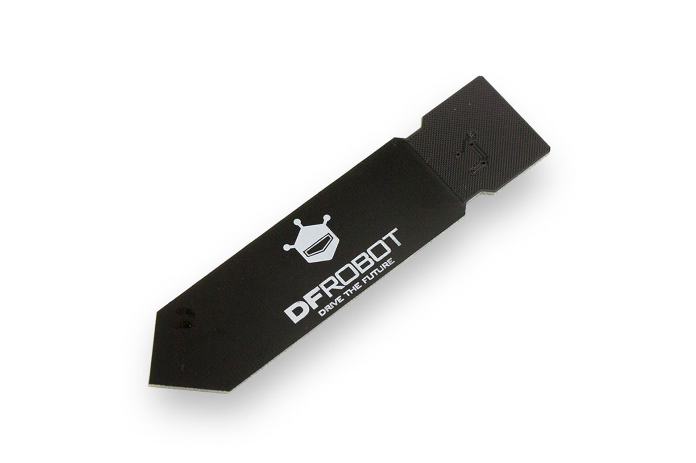
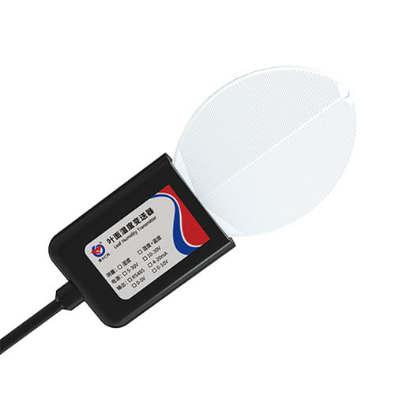
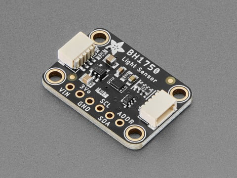
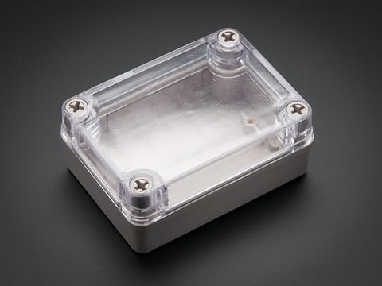

# AI-Powered Plant Health Monitoring and Disease Detection Using IoT & WSN

System: PlantGuard

Simran Batwal | Roll number: 28452500003

M.Tech | Computer Science | 3rd Semester

Guru Nanak Dev University, Amritsar

Guide: Dr. Anil Kumar

8 September 2026 | Initial-stage proposal

# Review purpose and present status

## Purpose of this submission
This initial-stage report presents the proposed college prototype, research direction, hardware requirements and validation plan for PlantGuard. It is intended for discussion with the project guide before implementation begins. The exact academic title is: **AI-Powered Plant Health Monitoring and Disease Detection Using IoT & WSN**.

PlantGuard will combine close-up leaf photographs with measurements of the plant environment. Two wireless sensor nodes will send readings to an existing laptop, which will run the AI models, store data and display evidence on a local dashboard.

| Activity | Status at this review |
| Topic selection and guide discussion | Undertaken; scope still open to guide feedback |
| Initial system planning | Undertaken; this report records the proposed approach |
| Research-paper reading | Some preliminary reading reported; detailed paper notes are still to be completed |
| Literature briefs in this pack | Prepared for discussion; not a claim that every paper has been fully studied by the student |
| Dataset acquisition and audit | Planned; no completed download is claimed |
| Coding, model training and experiments | Not started; planned after scope review |
| Hardware procurement and assembly | Proposed; subject to availability and institutional approval |

## Decisions requested from the guide
Confirm the primary research question, the tomato-first experimental scope, the model comparisons and the two-node hardware setup. Advise on access to plant-disease expertise, data collection, the review schedule and any departmental report format.

The project is at an initial planning review. The next phase will establish a dated work log, verified data inventory and reproducible implementation. No performance results, completed experiments or approvals are implied.

# Abstract and problem definition

## Proposed abstract
Plant disease recognition from photographs is useful, but image quality, unseen conditions and changes in field appearance can make predictions unreliable. Environmental measurements provide additional context, although a sensor reading alone does not establish a disease diagnosis. PlantGuard proposes a college-scale system that brings these sources together while retaining their limitations.

Two ESP32-based wireless sensor nodes will monitor soil-moisture response, air temperature, relative humidity and leaf-surface wetness around two tomato plants. A phone or USB camera will provide close-up leaf images. A laptop will perform image inference, maintain time-stamped sensor records, assess input quality and present the resulting evidence. The system will distinguish a current visual finding from an environmental risk indicator and will request another observation when evidence is inadequate.

The proposed experimental work will compare four image-model families, examine performance on data from different capture conditions and evaluate the effect of missing or degraded inputs. A focused research extension will investigate whether quality-aware fusion and a bounded rescan policy improve decision reliability at a reasonable sensing cost. Supervised disease forecasting will be attempted only if suitable independent time-labelled disease events are available.

Expected outputs include a reproducible image benchmark, a two-node wireless prototype, a local dashboard, a labelled data log and an evaluation report. This submission describes the plan; it does not report a completed system or measured accuracy.

## Problem statement
How can a resource-conscious college prototype combine image and environmental evidence without presenting uncertain, stale or faulty measurements as a reliable disease diagnosis?

## Why the problem matters
Controlled-dataset accuracy can overstate performance on unfamiliar images [R1, R2]. Image-sensor integration already appears in published research [R3, R4]. Therefore, PlantGuard should demonstrate reliable behaviour under practical input limitations and substantiate any improvement through controlled comparisons.

# Objectives and manageable scope

| Objective | Proposed evidence of completion |
| Monitor two plant zones wirelessly | Independent node IDs; time-stamped readings visible on one laptop |
| Compare four vision approaches | Same documented data split; per-class and overall metrics; compute cost |
| Handle uncertain inputs | Unknown / low-quality output and rescan flow tested on held-out examples |
| Integrate contextual evidence | Image and sensor history aligned by plant, zone and capture time |
| Evaluate robustness | Missing readings, noisy inputs and network interruption tests |
| Support reviewable advice | Management record with source, crop, condition and review date |

## Core college deliverable
Use **tomato** for the physical setup and first integrated classification task: healthy, early blight and late blight, plus rejection of unsupported or inadequate inputs. These image labels do not mean that all conditions will be grown experimentally in the two pots. The pots primarily demonstrate monitoring and data integration.

Compare MobileNetV3 Large, ResNet50, EfficientNet-B0 and a small pretrained ViT configuration under a common protocol. Select one deployment model using validation performance, calibration and laptop inference cost. Four comparisons do not require all four models to run simultaneously in the final demonstration.

## Data-dependent extensions
The wider project vision includes potato, maize, apple, grape, pepper and rice as additional image domains. Keep a dataset feasibility matrix for these crops; add them only after the tomato pipeline is stable and the guide agrees. Field validation across seven crops is not promised by a two-pot study.

Severity segmentation, learned risk forecasting, GRU/LSTM comparisons and continual learning require suitable labels or historical events. They are candidate extensions, not unconditional prototype commitments. Automatic irrigation, chemical spraying, solar power and a dedicated AI computer are outside the proposed college build.

# College architecture and information flow

**Architecture:** sensors -> ESP32 nodes A/B -> local Wi-Fi -> laptop broker/database -> laptop AI/dashboard. Camera -> zone/time-linked image intake on laptop.
Figure 1. Proposed local college architecture. Arrows represent information flow, not a circuit wiring diagram.

## How one observation moves through the system
1. The sensors measure their local environment. Each ESP32 adds its node identity and measurement status.
2. Node A and Node B send telemetry over the same Wi-Fi network. USB connections may supply power or support debugging; the final sensor-data path remains wireless.
3. The laptop checks incoming records, stores them and flags missing or implausible values.
4. The student captures a close-up leaf photo and selects the crop, plant and zone. The capture time is recorded.
5. A model processes the image. The application retrieves only relevant sensor history from that same zone and time window.
6. The dashboard shows the visual result, input quality, environmental context, uncertainty and a reviewable next action.

An existing access point provides connectivity; an internet connection is not required for the local demonstration after dependencies and model files are installed. A phone hotspot is usable only after checking that it permits device-to-device communication.

The laptop is the processing platform. The ESP32 is the sensing and communication controller. An optional communication gateway is unnecessary for the first two-node Wi-Fi prototype.

# Physical setup and placement

**Setup:** two labelled tomato pots with soil probes, shielded air sensors and separate supported wetness plates; a shared stable camera and laptop.
Figure 2. Proposed two-pot setup, drawn schematically. Identical components are used in both zones.

| Part of setup | Placement and purpose |
| Two tomato plants | Similar compact cultivar and growth stage; separate labelled 10-15 L pots with drainage trays |
| Soil probe | In representative root-zone medium; record insertion depth and distance from pot wall |
| SHT31 air sensor | Near canopy in a ventilated radiation shield, away from direct spray and electronics heat |
| Artificial leaf-wetness plate | On its own support near representative foliage; use the manufacturer orientation and record it |
| Camera | Stable stand with repeatable distance, sufficient focus and diffuse illumination |
| ESP32 and wiring | Protected above tray level with strain relief and separated wet / dry areas |

The wetness plate is a proxy surface near the canopy; it is not a clip that must be attached to every leaf. The two pots are two measurement locations, not two statistically adequate disease-treatment groups.

Keep a simple care log: watering time and amount, visible plant condition, light changes, sensor movement and maintenance. Avoid introducing pathogens for a classroom demo. Use appropriately sourced labelled photographs for disease examples; any biological experiment needs a separately reviewed protocol and expertise.

# Controller and sensor selection

[Product-family source](https://docs.espressif.com/projects/esp-idf/en/v4.3.6/esp32/hw-reference/esp32/get-started-devkitc.html)

[Product-family source](https://www.dfrobot.com/product-1385.html)

[Product-family source](https://www.adafruit.com/product/2857)

| Component | Preferred choice and reason |
| Controller | Two matching ESP32 DevKitC V4 boards with ESP32-WROOM-32E modules; integrated Wi-Fi and adequate interfaces [H1](https://docs.espressif.com/projects/esp-idf/en/stable/esp32/hw-reference/esp32/get-started-devkitc.html) |
| Soil measurement | Capacitive SEN0193-class probe; use calibration and record raw ADC as well as a relative index [H2](https://wiki.dfrobot.com/Capacitive_Soil_Moisture_Sensor_SKU_SEN0193) |
| Air conditions | SHT31 I2C breakout, preferred over a basic DHT22 for the planned build; protect the sensing element [H3](https://www.adafruit.com/product/2857) |

## Why ESP32 rather than a separate Arduino Uno
ESP32 provides the controller and Wi-Fi on one development board. It can be programmed in C++ using the Arduino framework. “Arduino” can refer to a software framework or a board family; using that framework does not require buying an Arduino Uno as well.

Check the exact purchased board before wiring. A generic ESP32 label does not guarantee the same connector, pin layout or module. Reference photographs identify component families; the quotation must identify the actual variant and included accessories.

## What the readings mean
The low-cost soil probe reports an electrical response influenced by the growing medium. A calibrated relative wetness index is suitable for this prototype; it must not be labelled volumetric water content without appropriate calibration. SHT31 measures local air temperature and relative humidity, not the temperature or water content of the leaf itself.

# Wetness, imaging and assembly choices

[Product-family source](https://www.renkeer.com/product/leaf-wetness-sensor/)

[Product-family source](https://www.adafruit.com/product/4681)

[Product-family source](https://www.adafruit.com/product/903)

## Leaf-wetness sensor
Use a genuine artificial leaf-wetness plate from a documented RS485 Modbus variant, such as the Renke RS-WS-*-YM-1-T family. Confirm the exact suffix, supply range, register map, cable and output units before ordering. A 3.3 V MAX3485 interface is budgeted between this sensor and each ESP32. A common 5 V MAX485 board is not an automatic substitute [H4, H5].

Leaf wetness adds information about moisture on a proxy surface. Humid air does not guarantee a wet leaf. Do not substitute an exposed rain-detection PCB and describe it as a calibrated leaf-wetness instrument. If the proper plate exceeds budget, record its omission and narrow the experiment.

## Camera and light
Start with an available smartphone or laptop camera. Purchase the budgeted USB webcam only if the available camera cannot focus adequately on a leaf. Compare sample images before purchase: sharpness, exposure, minimum focus distance, colour consistency and mounting matter more than the “1080p” label alone.

BH1750 is an optional light-context sensor [H6](https://www.adafruit.com/product/4681). It measures illuminance in lux, not photosynthetically active radiation. It is not required for the first minimum working prototype.

## Practical accessories
Budget for data-capable USB cables, breadboards, insulated wires, terminals, regulated supplies, fuse protection, standoffs, glands, sensor shields, a camera stand, pots, trays and plant labels. Borrow a multimeter and soldering tools where available. Enclosure selection must accommodate wiring and ventilation; the assembled prototype is not automatically certified weatherproof.

# Interfaces and calibration plan

| Function | Provisional interface on classic ESP32 DevKitC |
| SHT31 and optional BH1750 | I2C; candidate SDA GPIO21 and SCL GPIO22; verify breakout pull-ups at 3.3 V |
| Capacitive soil probe | ADC1 input, candidate GPIO34; verify the output stays within the selected ADC range |
| RS485 transceiver | UART, candidate RX GPIO16 / TX GPIO17, direction GPIO25; verify board availability |
| Power | Board through a verified USB supply; separate matched sensor supply where required |

These pin choices are a design starting point for the classic WROOM-32E board, not universal wiring instructions. Review the exact modules and sensor manuals before energising the circuit. ADC1 is chosen for soil sampling to avoid classic ESP32 ADC2/Wi-Fi resource conflicts.

## Calibration and commissioning sequence
1. Inspect part markings and supplies with a multimeter. Check polarity, common signal reference and logic voltage compatibility.
2. Read one sensor at a time before assembling the full node. Store raw readings and the sensor/model identifier.
3. Calibrate the soil response in the actual medium using repeatable reference states. Keep calibration coefficients versioned per probe.
4. Co-locate the two air sensors and compare stable readings. Record differences; use a reference instrument if available.
5. Check dry and uniformly wetted plate response according to its manual. Select a wet/dry threshold only from this evidence and retain the raw output.
6. Verify serial/register settings, then run both nodes continuously. Record gaps, resets and disagreement between co-located sensors.

A low-cost calibrated prototype supports comparative measurements. It does not establish laboratory-grade accuracy, absolute water content or a universal disease threshold.

# Literature review 1: image generalisation

## R1. Mohanty, Hughes and Salathe (2016)
**Method and evidence.** The study trained deep image classifiers using 54,306 controlled leaf images across 14 crops. It reported 99.35% held-out accuracy under its dataset conditions. Performance on differently sourced images was much lower, just above 31% in the paper's external test.

**Critical reading.** The difference between internal and external performance is more informative for PlantGuard than the high headline accuracy. Background and capture conditions can become shortcuts. These are the paper's results, not results obtained in this project.

**Design implication.** Maintain a clean internal test set and a separate external-condition evaluation. Record where images came from and prevent related images crossing the split [R1](https://doi.org/10.3389/fpls.2016.01419).

## R2. Singh et al. (2020)
**Method and evidence.** PlantDoc introduced a web-collected, non-laboratory dataset with 2,598 data points spanning 13 plant species and up to 17 disease classes. Its focus is the practical difficulty of recognising disease beyond clean laboratory images.

**Critical reading.** This is a comparatively small and heterogeneous dataset. Image provenance, labels and repeated sources need auditing. Web collection is not the same as a prospectively controlled local field study.

**Design implication.** Use supported tomato classes as an external challenge set after verifying label compatibility. Do not attach invented environmental readings to these images [R2](https://arxiv.org/abs/1911.10317).

## Questions to take into full reading
Which split unit was used? How were duplicates handled? Which classes are comparable across datasets? What changes between the training environment and the external evaluation? Record answers in the paper-reading tracker before making stronger claims.

# Literature review 2: image-sensor fusion

## R3. Chen et al. (2024)
**Method and evidence.** The peach-tree study combines image and sensor features for disease recognition and segmentation. It introduces an alignment mechanism to bring different feature representations together before using their combined information.

**Critical reading.** A successful crop-specific study does not automatically transfer to tomato or to inexpensive sensors. For a reproducible comparison, inspect how samples were aligned, which modalities were removed in ablations and how independent evaluation data were separated.

**Design implication.** Image-plus-sensor fusion is established prior work. PlantGuard's contribution must be narrower and experimentally demonstrated, such as behaviour under poor-quality or missing inputs [R3](https://doi.org/10.3390/agriculture14060797).

## R4. Gao et al. (2026)
**Method and evidence.** This protected-horticulture study combines tomato leaf images with environmental time series and links risk estimates to greenhouse control. The authors report approximately 0.95 accuracy and more than 20 hours of warning in their study setting.

**Critical reading.** Their measurements arise from a real greenhouse dataset and a specific experimental protocol. The same lead time cannot be promised from two college pots. Before adopting the method, examine event labels, time splits and what information is available before disease onset.

**Design implication.** Use the study to distinguish current diagnosis from prospective forecasting and to motivate time-aligned data collection. Do not claim early warning until it is measured on independent future events [R4](https://doi.org/10.3390/horticulturae12030299).

## Proposed review outcome
Ask the guide whether the thesis should prioritise reliability-aware diagnosis or forecasting. The first is feasible with controlled quality tests; the second depends on obtaining a sufficiently informative longitudinal disease dataset.

# Literature review 3: unfamiliar conditions

## R5. Wei et al. (2024)
**Method and evidence.** PlantWild addresses disease recognition in varied real-world imagery and introduces a multimodal baseline using image and text information. It studies the difficulty of distinguishing similar diseases under diverse appearance conditions.

**Critical reading.** Image-text multimodality is different from image-environmental-sensor fusion. Dataset versions and licence terms must be tracked; the project lists non-commercial terms that require separate consideration for any later product use.

**Design implication.** Use this work as a reference for domain variation and dataset auditing. Include only compatible classes and permitted data in a college experiment [R5, D3].

## R6. Dong et al. (2025)
**Method and evidence.** The paper studies anomaly detection in plant-disease recognition with a knowledge ensemble, combining general pretrained knowledge and task-adapted knowledge. It evaluates unfamiliar conditions rather than treating every image as a known class.

**Critical reading.** Known-class accuracy and unknown-input detection measure different capabilities. An unknown detector may reject legitimate examples, so its threshold needs a separate validation protocol.

**Design implication.** Add unsupported-condition and inadequate-image outcomes. Compare rejection behaviour against a simple validation-tuned confidence baseline, using an untouched unknown test set [R6](https://doi.org/10.3389/fpls.2025.1623907).

## What will be tested in PlantGuard
Challenge examples may include the wrong crop, a non-leaf object, severe blur, overexposure and a disease outside the supported classes. Keep data-quality rejection separate from biological novelty; an out-of-focus photograph is not evidence of a new disease.

# Literature review 4: updates and advice

## R7. Wang (2024)
**Method and evidence.** This study explores zero-exemplar continual learning for crop-disease recognition with a vision transformer and total-variation attention regularisation. It addresses loss of earlier knowledge when a model learns new disease tasks.

**Critical reading.** Continual-learning evaluation must measure both retained old-task performance and new-task performance. “Improving over time” cannot be assumed from simply retraining on fresh images.

**Design implication.** Archive newly collected examples for expert review. Any later model update should be versioned, tested and reversible. Automatic self-training from PlantGuard's own predictions is outside the initial prototype [R7](https://doi.org/10.3389/fpls.2023.1283055).

## R8. Ding, Qiao and Zhang (2023)
**Method and evidence.** PRSER retrieves plant-disease prescriptions using sentence embeddings of plant electronic medical records. The approach uses existing records and semantic matching to support recommendation.

**Critical reading.** Historical records from one agricultural context are not automatically appropriate for a different crop, location or registered product label. Retrieval relevance alone does not establish treatment correctness.

**Design implication.** The college dashboard should present a small, expert-reviewed management knowledge base with traceable sources and review dates. It should not invent chemical products or doses [R8](https://doi.org/10.1186/s13007-023-01070-6).

## Review status and next reading task
These are preliminary literature briefs prepared for this discussion. The student has reported some initial reading; full methods, supplementary material and reproducibility checks remain part of the work plan. No claim of an exhaustive systematic literature review is made.

Priority for the next meeting: complete full notes for R1, R2, R3 and R4, then explain in one minute what each changes in the proposed design.

# Research question and contribution

## Primary proposed question
Does quality-aware use of environmental context, together with a bounded request for fresh evidence, improve the reliability of plant-health decisions compared with a fixed image-only or naive-fusion pipeline?

The proposed contribution is an evaluated decision policy under practical input limitations. It is not a claim that image classification, sensor networking, fusion, unknown detection or treatment retrieval is individually new.

| Comparison | What changes | What remains comparable |
| A. Image-only baseline | Photograph alone | Same eligible examples and class definition |
| B. Simple context baseline | Image plus available sensor summary | Same time / zone alignment and test cases |
| C. Quality-aware policy | Ignores stale / faulty context; permits abstention | Same trained vision model and evaluation set |
| D. Bounded evidence policy | Requests a rescan or short sampling burst | Same fixed budget and predeclared stopping rule |

## Conditions for a defensible study
For a learned fusion classifier, obtain genuinely paired images, sensor histories and independent labels. If those are insufficient, evaluate a rule-based evidence policy and clearly describe it as such. Synthetic fault injection can test software robustness; it cannot validate real biological disease prediction.

## Predeclared outcomes
Compare macro-F1, per-class recall, error among accepted predictions, fraction of cases accepted, unknown false acceptance, false alerts and extra observations requested. Measure end-to-end latency and data volume. Report trade-offs and failure cases, including no improvement if that is what the evidence shows.

The exact hypothesis, baselines and experiment size should be refined with the guide before model development. A small negative result with a sound protocol is more useful than an unsupported performance claim.

# Dataset acquisition and labelling

| Data source | Planned role | Required check |
| PlantVillage [D1](https://github.com/spMohanty/PlantVillage-Dataset) | First controlled-image benchmark | Selected crop / class mapping, duplicates, source and licence |
| PlantDoc [D2](https://github.com/pratikkayal/PlantDoc-Dataset) | External-condition evaluation | Compatible labels, source overlap and image quality |
| PlantWild [D3](https://tqwei05.github.io/PlantWild/) | Optional additional domain challenge | Version, class overlap, permitted academic use |
| Own two-pot observations | Integration, quality and telemetry tests | Plant / zone IDs, capture time, care log and label provenance |
| Expert-supported longitudinal data | Optional fusion / forecast learning | Independent disease events, timing and expert labels |

## Acquisition steps after this review
Create a dataset manifest before training: dataset name, source URL, version or retrieval date, licence, file count, class mapping and exclusions. Download only the chosen subset, retain an unchanged raw copy and generate checksums. Dataset download is currently a planned task.

Split data before augmentation. Keep related images from the same plant, capture session or original source together. Detect exact and near duplicates. Use a held-out test set once the protocol is fixed; use validation data for model and threshold selection.

For own observations, link each image to a plant ID, zone ID, capture timestamp and recent sensor window. Do not assign local sensor values to unrelated public images. Annotate the basis of the label: expert confirmation, dataset label, uncertain visual observation or unlabelled example.

If the guide permits additional crops, create a crop-by-class feasibility table first. Report each dataset's coverage rather than implying that every disease exists for every crop.

Two pots can generate many correlated readings. Thousands of rows from those pots are not thousands of independent disease cases.

# Model and decision pipeline

## Image-model workflow
Start from pretrained weights for MobileNetV3 Large, ResNet50, EfficientNet-B0 and a manageable ViT configuration. Use each model's documented input preprocessing, a common split and comparable tuning effort. Log seed, software versions, parameters and checkpoints. Use validation-based stopping and class-aware metrics.

The final deployment model is selected after comparison. Measure latency on the actual laptop; GPU training may use approved institutional resources if necessary. This proposal does not assume a new GPU purchase or guaranteed real-time speed.

## Environmental context and fusion
Start with transparent, reviewed rules and rolling sensor summaries. Preserve raw readings, missing-value flags and calibration versions. Separate a current image classification from an environmental risk indicator. A high-risk environment can coexist with a visually healthy leaf; these are not contradictory labels for the same target.

If sufficient paired labelled examples exist, compare simple late fusion and a compact feature-based model. RF/XGBoost are candidates for tabular summaries; GRU/LSTM become relevant only when enough independent, labelled sequences are available.

## Bounded adaptive evidence
An initial policy may request one better photo and, if necessary, a short higher-frequency sensor burst. Cap retries and time, log every request, and return “insufficient evidence” when the limit is reached. Compare the gain against additional user effort and sensor transmissions.

## Explanations and severity
A Grad-CAM-style heatmap can help inspect where a compatible CNN looks; it is not a verified lesion outline. A severity percentage needs lesion annotations, an appropriate segmentation method and validation. Until then, show the image and evidence without claiming a numeric diseased-area estimate.

# Software, records and dashboard

| Layer | Proposed implementation |
| Node firmware | C++ with Arduino framework; sensor readout, reconnect, sequence number and health flags |
| Telemetry | Local Wi-Fi and MQTT; laptop broker; credentials and node-specific identity |
| Application | Python FastAPI service; validation, image intake and inference |
| Research | PyTorch, OpenCV and scikit-learn; XGBoost only if the experiment requires it |
| Storage | SQLite initially; separate original images and structured records |
| Dashboard | React with TypeScript; local browser interface |

## Minimum record structure
Each reading stores node ID, zone ID, sequence number, device time if valid, laptop receive time, measurement values, units, validity flags and calibration version. Each image stores image ID, plant ID, zone ID, capture time, crop, label provenance and permitted-use status. Each prediction stores model version, input references, confidence, rejection reason and decision-policy version.

Reject malformed records, detect duplicate transmissions and expose missing data. After a connection loss, show the last valid timestamp and an offline indicator; do not display old data as a current measurement. Keep local backups of raw data, manifests and experiment logs.

## Dashboard screens
1. Overview: two zone cards, current values, last contact and sensor-health state.
2. Scan: crop / plant selection, image capture or upload and image-quality feedback.
3. Evidence: image finding, environmental context and uncertainty shown separately.
4. History: time trends, gaps, image events and care-log entries.
5. Review: source-linked management notes and export of a dated observation report.

Any sample dashboard screenshot must be labelled illustrative until it shows a real measured run. Use explicit “demo data” tags for rehearsals that rely on prerecorded examples.

# Evaluation and acceptance criteria

| Area | Proposed test and report |
| Image recognition | Macro-F1, per-class precision / recall, confusion matrix; internal and external results separately |
| Calibration / rejection | Reliability of confidence, accepted-case error versus coverage; unfamiliar-input false acceptance |
| Sensor and network | Co-location checks, calibration records, missing data rate, recovery after a deliberate disconnect |
| Context policy | Same cases across baselines; ablations for missing / stale / noisy sensor inputs |
| Adaptive observations | Change in accepted-case error versus number of rescans and extra transmissions |
| Forecasting, if justified | Prospective event-based split; false alerts and lead time relative to labelled onset |
| Usability | Student can complete scan, identify zone and understand an uncertain result |

## Prototype acceptance targets to agree with the guide
Demonstrate both wireless nodes simultaneously and preserve their identities. Complete a 24-hour logging run with a documented gap report. Exercise one reconnect event and show that stale values are marked. Capture and analyse one correctly linked image for each zone. Demonstrate a poor-quality or unsupported input without forcing a confident diagnosis.

These are proposed engineering acceptance checks, not completed achievements. A provisional target is at least 95% of expected telemetry records received during the controlled logging run; the actual figure and causes of gaps must be reported.

## Research reporting discipline
Use the same split and tuning rules for comparisons. Estimate uncertainty using independent units such as plant, session or event, rather than treating adjacent sensor readings as independent replicates. Record training cost and deployment latency. Publish limitations, class imbalance and failure examples alongside the best result.

No minimum disease-recognition accuracy is promised before the data audit. The experiment should establish what the model can support, including where it fails.

# Work plan and review milestones

Time is counted from the guide's scope review, not backdated. The following is a provisional 180-day plan; it should be shortened or adjusted to the official submission calendar.

| Period | Work package | Reviewable output |
| Days 1-7 | Refine question, full notes for four core papers, confirm inventory | Signed-off scope notes; paper matrix; quotation shortlist |
| Days 8-14 | Download / audit chosen datasets; receive first parts | Dataset manifest, class counts and receiving checklist |
| Days 15-21 | One-node sensor bring-up, calibration and local logging | Raw logs and calibration notes; no AI claims yet |
| Days 22-30 | Add second wireless node and camera intake | Two-zone logging demo and first aligned observations |
| Days 31-60 | Four image baselines and reproducible evaluation | Baseline comparison, errors and laptop timings |
| Days 61-90 | Input-quality handling and contextual decision policy | Unknown / fault cases; documented fusion feasibility decision |
| Days 91-120 | Focused policy experiments and dashboard integration | Ablation results; bounded rescan behaviour |
| Days 121-150 | Robustness evaluation; optional data-ready extensions | Final experiment tables and limitations |
| Days 151-180 | Thesis, demonstration rehearsal and paper draft if justified | Final report, reproducible package and presentation |

## First review checkpoint
At the end of the first week, show the guide four completed paper notes, a narrow research question, the dataset manifest template and two or three usable quotations where available. If procurement is delayed, continue dataset audit and offline image baselines after scope approval.

## Change rule
Record any guide-requested change with its reason, revised deliverable and effect on cost or schedule. Do not add every interesting feature to the first build. Protect time for evaluation and writing.

# Resources, risks and academic outputs

## Resource request
The separate physical-parts proposal estimates **INR 18,150** before contingency and **INR 21,780** including a 20% procurement contingency. The figures are planning allowances, not vendor quotations. They include two leaf-wetness plates and a conditional webcam purchase. Borrow the laptop, Wi-Fi access point and available laboratory tools.

| Constraint | Proposed response |
| Scope becomes too broad | Keep tomato integration and one research question as the core |
| Insufficient labelled disease events | Report monitored context; defer supervised forecasting |
| Leaf-wetness plate is costly / unavailable | Seek exact-variant quotations; stage the purchase or explicitly reduce scope |
| Model succeeds only on clean images | Report external-condition results and failure categories |
| Sensor drift or missing packets | Keep raw values, calibration records, sequence numbers and quality flags |
| Plant variability | Log care conditions; avoid biological efficacy claims from two pots |
| Timeline pressure | Prioritise a working baseline, sound evaluation and a reproducible report |

## Expected academic outputs
A working two-zone demonstration; a documented hardware/interface design; a reproducible dataset audit and image-model comparison; a focused robustness experiment; a local dashboard; and a thesis report with honest limitations.

A research-paper manuscript may follow if the work produces a clear question, valid comparisons and sufficiently supported findings. A publication or acceptance cannot be promised. An initial outline can be prepared now: introduction, related work, methods, experimental design, results to be filled after experiments, discussion and limitations.

The guide's feedback is requested on study scope, biological labelling support, compute access and which extension should be removed first if time or data are limited.

# Future possibility and guide review record

## Optional path beyond the college prototype
If the college study demonstrates useful and reproducible behaviour, a later pilot could use weather-protected sensor boxes, better field imaging and a hosted PlantGuard service. In that version, **all main AI inference and analysis run on a VPS / cloud server**. Sensor boxes measure and transmit; any field gateway only provides communication and buffering.

This future path would require field validation, suitable data rights, device durability tests, account security, operating-cost measurement and user trials. It is a possible continuation, not a market-ready claim or part of the present hardware-funding request.

## Items for guide feedback
| Decision | Comments / agreed change |
| Tomato-first physical and integrated scope | __________________________________ |
| Primary research question and baseline set | __________________________________ |
| Dataset choices and labelling support | __________________________________ |
| Two-node hardware and leaf-wetness requirement | __________________________________ |
| Optional features to defer | __________________________________ |
| Expected review frequency and submission date | __________________________________ |

## Next meeting record
Review date: ____________________    Next meeting: ____________________

Priority task 1: __________________________________________________

Priority task 2: __________________________________________________

Priority task 3: __________________________________________________

Student: Simran Batwal    Roll number: 28452500003

Guide: Dr. Anil Kumar    Signature: ____________________

This record is intentionally blank for the actual meeting. It does not indicate approval.

# References: research literature

**R1.** S. P. Mohanty, D. P. Hughes and M. Salathe (2016). Using Deep Learning for Image-Based Plant Disease Detection. Frontiers in Plant Science, 7:1419. [Open primary source](https://doi.org/10.3389/fpls.2016.01419)

**R2.** D. Singh et al. (2020; preprint 2019). PlantDoc: A Dataset for Visual Plant Disease Detection. CODS-COMAD. [Open primary source](https://arxiv.org/abs/1911.10317)

**R3.** K. Chen et al. (2024). Integration of Image and Sensor Data for Improved Disease Detection in Peach Trees Using Deep Learning Techniques. Agriculture, 14(6):797. [Open primary source](https://doi.org/10.3390/agriculture14060797)

**R4.** P. Gao et al. (2026). Environmental-Visual Fusion for Proactive Tomato Late Blight Management in Protected Horticulture. Horticulturae, 12(3):299. [Open primary source](https://doi.org/10.3390/horticulturae12030299)

**R5.** T. Wei, Z. Chen, Z. Huang and X. Yu (2024). Benchmarking In-the-Wild Multimodal Disease Recognition and A Versatile Baseline. ACM Multimedia. [Open primary source](https://arxiv.org/abs/2408.03120)

**R6.** J. Dong, H. Zhou, A. Fuentes, S. Yoon and D. S. Park (2025). Enhancing anomaly detection in plant disease recognition with knowledge ensemble. Frontiers in Plant Science, 16:1623907. [Open primary source](https://doi.org/10.3389/fpls.2025.1623907)

**R7.** B. Wang (2024, volume 14/2023). Zero-exemplar deep continual learning for crop disease recognition: a study of total variation attention regularization in vision transformers. Frontiers in Plant Science. [Open primary source](https://doi.org/10.3389/fpls.2023.1283055)

**R8.** J. Ding, Y. Qiao and L. Zhang (2023). Plant disease prescription recommendation based on electronic medical records and sentence embedding retrieval. Plant Methods, 19:91. [Open primary source](https://doi.org/10.1186/s13007-023-01070-6)

Source links reviewed for this planning pack on 8 September 2026. Literature findings refer to the cited studies and do not represent PlantGuard results.

# References: data and hardware

**D1.** PlantVillage public dataset repository. Verify the selected files, source, labels and licence before use. [Open primary source](https://github.com/spMohanty/PlantVillage-Dataset)

**D2.** PlantDoc dataset repository. Web-collected plant images; maintain source-level separation. [Open primary source](https://github.com/pratikkayal/PlantDoc-Dataset)

**D3.** PlantWild project and dataset terms. Its image-text multimodality differs from environmental sensor fusion. [Open primary source](https://tqwei05.github.io/PlantWild/)

**H1.** Espressif. ESP32-DevKitC V4 hardware reference, interfaces and board power options. [Open primary source](https://docs.espressif.com/projects/esp-idf/en/stable/esp32/hw-reference/esp32/get-started-devkitc.html)

**H2.** DFRobot. SEN0193 capacitive soil moisture sensor reference. [Open primary source](https://wiki.dfrobot.com/Capacitive_Soil_Moisture_Sensor_SKU_SEN0193)

**H3.** Adafruit. SHT31-D temperature and humidity sensor breakout reference. [Open primary source](https://www.adafruit.com/product/2857)

**H4.** Renke. Leaf-wetness sensor family; obtain a variant-specific quotation and RS485 manual. [Open primary source](https://www.renkeer.com/product/leaf-wetness-sensor/)

**H5.** Analog Devices. MAX3483/MAX3485 family, 3.3 V RS485 transceivers. [Open primary source](https://www.analog.com/en/products/max3485.html)

**H6.** Adafruit. BH1750 light sensor reference. [Open primary source](https://www.adafruit.com/product/4681)

Source links reviewed for this planning pack on 8 September 2026. Literature findings refer to the cited studies and do not represent PlantGuard results.
