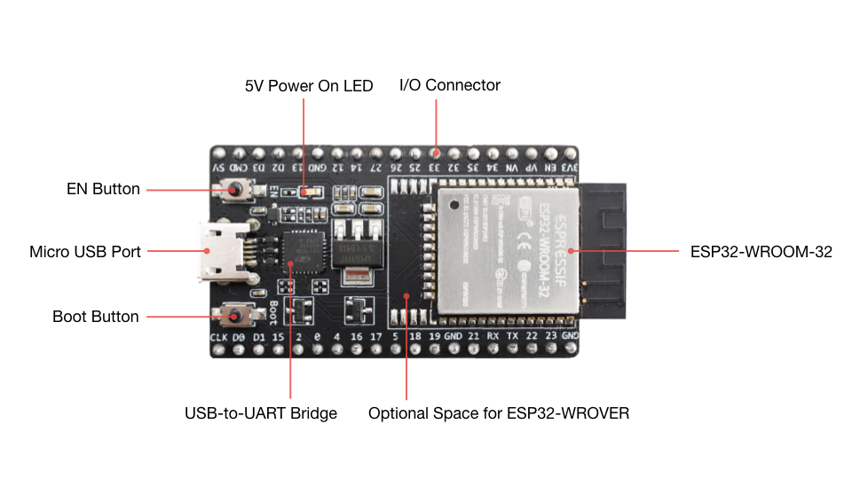
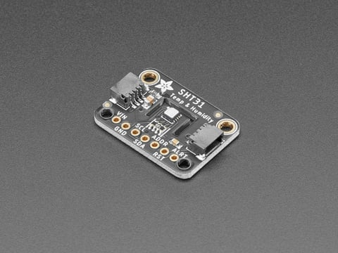
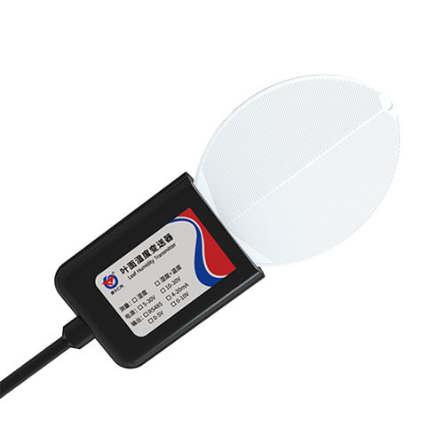
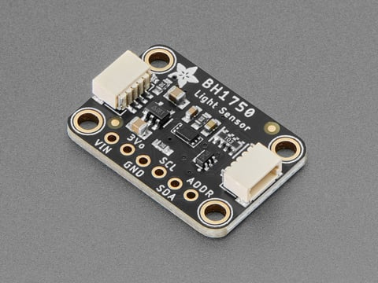
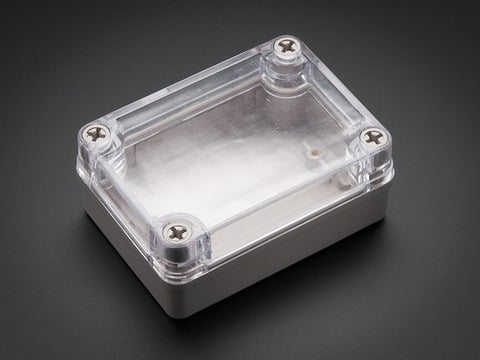

# AI-Powered Plant Health Monitoring and Disease Detection Using IoT & WSN

System: PlantGuard

Simran Batwal | Roll number: 28452500003

M.Tech | Computer Science | 3rd Semester

Guru Nanak Dev University, Amritsar

Guide: Dr. Anil Kumar

8 September 2026 | Initial-stage proposal

# Request and academic justification

To: Dr. Anil Kumar, Project Guide

For consideration through the appropriate departmental approving authority

Computer Science, Guru Nanak Dev University, Amritsar

**Subject: Request for financial support for the PlantGuard college prototype**

Respected Sir / Madam,

I, Simran Batwal, a student of M.Tech, Computer Science, 3rd Semester, request consideration of financial support for the physical components required for my proposed project, **AI-Powered Plant Health Monitoring and Disease Detection Using IoT & WSN**, with the system name **PlantGuard**.

The proposed prototype will use two tomato plants, two wireless ESP32 sensor nodes, environmental sensors and a camera connected to an existing laptop-based application. It will support practical work in wireless sensing, data acquisition, AI evaluation and evidence-based plant-health monitoring. Coding and procurement are planned after review of the scope.

The indicative hardware and consumables subtotal is **INR 18,150**. With a **20% contingency of INR 3,630**, the proposed approval ceiling is **INR 21,780**. This is an estimate for planning; actual procurement will depend on accepted quotations, institutional procedure and the final approved configuration.

The laptop, network access point and available laboratory tools will be reused. No VPS subscription, dedicated AI processing box, new computer, GPU or cloud-training expense is included. The optional light sensors and conditional webcam can be omitted if unnecessary.

Kindly review the attached itemised requirement and advise whether support should be through departmental purchase, an approved advance or reimbursement against invoices. Any budget adjustment can be recorded on the approval page.

Yours faithfully,

**Simran Batwal**

Roll number: 28452500003    Date: ____________________

Student signature: ____________________

# Itemised estimate 1: electronics

All amounts are in INR. Quantities cover **two nodes** unless stated otherwise. Unit figures are provisional allowances, not current vendor offers; obtain quotations for the exact selected variants before purchase.

| Item | Qty | Unit INR | Total INR |
|---|---:|---:|---:|
| ESP32 DevKitC V4 / WROOM-32E, matched pair (Core) | 2 | 600 | 1,200 |
| Capacitive soil-moisture probe, SEN0193 class (Core) | 2 | 350 | 700 |
| SHT31 temperature / humidity breakout (Core) | 2 | 450 | 900 |
| Artificial leaf-wetness plate, RS485 variant (Quote required) | 2 | 3,500 | 7,000 |
| 3.3 V MAX3485 RS485 interface module (Core) | 2 | 300 | 600 |
| BH1750 lux sensor (Optional) | 2 | 150 | 300 |
| Breadboard / prototype base (Core) | 2 | 200 | 400 |
| Mixed jumpers and insulated hookup wire, lot (Core) | 1 | 400 | 400 |
| USB data cable matched to purchased board (Core) | 2 | 150 | 300 |
| Regulated supplies and distribution, lot (Core) | 1 | 600 | 600 |

## Technical purchase conditions
The boards must be a matching classic ESP32 DevKitC V4 / WROOM-32E pair, with pinout and USB connector confirmed. Use data-capable cables. Match the SHT31 breakout and I2C pull-ups to 3.3 V operation.

For each leaf-wetness plate, obtain the exact RS485 Modbus variant, supply specification, register map, included cable and warranty terms. The INR 3,500 unit allowance must be replaced by a valid quotation. The associated transceiver must expose ESP32-compatible 3.3 V logic.

The supply/distribution allowance covers regulated low-voltage power appropriate to the purchased variants. If a plate needs a separate supply, include it in the actual quotation; do not connect a higher-voltage sensor supply to ESP32 logic pins.

BH1750 is optional. Omitting both light sensors reduces the subtotal by INR 300. The core two-node study can start without them.

# Itemised estimate 2: setup and total

| Item | Qty | Unit INR | Total INR |
|---|---:|---:|---:|
| Gasketed prototype enclosure (Core) | 2 | 350 | 700 |
| Glands, terminals, fuse and standoffs, lot (Core) | 1 | 500 | 500 |
| USB webcam with usable close focus (If needed) | 1 | 1,500 | 1,500 |
| Camera / sensor stands and air shields, lot (Core) | 1 | 800 | 800 |
| Tomato seedlings, similar compact cultivar (Core) | 2 | 150 | 300 |
| 10-15 L pot with drainage tray (Core) | 2 | 300 | 600 |
| Consistent potting medium, lot (Core) | 1 | 500 | 500 |
| Plant stakes, labels and soft ties, lot (Core) | 1 | 250 | 250 |
| Spare connectors and assembly consumables (Core) | 1 | 600 | 600 |

**Subtotal INR 18,150 + 20% contingency INR 3,630 = ceiling INR 21,780.**

The contingency is a reserve for quotation variation, taxes, shipping or small necessary accessories where not already included. Actual invoices must avoid double counting these charges. Spending above the approved ceiling requires a revised institutional request.

# Savings and staged purchasing

## Configuration options
| Configuration | Subtotal | 20% reserve | Planning ceiling |
| Full proposed physical setup | 18,150 | 3,630 | 21,780 |
| Reuse a suitable available camera | 16,650 | 3,330 | 19,980 |
| Omit optional BH1750 pair | 17,850 | 3,570 | 21,420 |
| Reuse camera and omit BH1750 pair | 16,350 | 3,270 | 19,620 |

The full setup is the request baseline. These alternatives preserve both wireless nodes and both leaf-wetness plates. Substituting a cheap rain PCB is not equivalent to funding the documented wetness measurement.

## How expenditure can be staged
Start by confirming the available laptop, camera, access point and laboratory tools. Test sample close-up images before committing to the webcam purchase. If a suitable camera is already available, use the lower configuration above.

The first procurement stage can cover the controller, soil and air measurements, power and basic assembly. The second can add documented leaf-wetness plates, their interfaces and enclosure integration once exact quotations and compatibility are confirmed. The full approved scope still requires both sensing nodes; staging does not mean reporting a one-node setup as the final WSN demonstration.

BH1750 sensors may be omitted without blocking the first integrated demonstration. Any omission of a core measurement must be reflected in the report, experiment design and final expense record.

## Quotation discipline
For each shortlisted supplier, compare the same technical variant and the complete delivered price. Include required cable lengths, supply adapters and protocol-conversion modules. Do not compare an analogue plate with an RS485 model as if they were the same part.

The separate quote-comparison sheet supplied with this pack is blank for actual offers and receipts. No supplier has been selected and no purchase order has been issued through this proposal.

# Visual component reference

[Product-family source](https://docs.espressif.com/projects/esp-idf/en/v4.3.6/esp32/hw-reference/esp32/get-started-devkitc.html)

[Product-family source](https://www.dfrobot.com/product-1385.html)

[Product-family source](https://www.adafruit.com/product/2857)

[Product-family source](https://www.renkeer.com/product/leaf-wetness-sensor/)

[Product-family source](https://www.adafruit.com/product/4681)

[Product-family source](https://www.adafruit.com/product/903)

The photographs are manufacturer/product-family references. They explain the required categories; they are not vendor quotations or a claim that a particular pictured brand fits the allowance. Equivalent parts need technical review before acceptance.

## Plant and camera setup
Two labelled 10-15 L pots with drainage trays, two similar tomato seedlings, one batch of medium, soft ties and stakes provide repeatable measurement locations. A shared camera stand should support sharp, close-up leaf photographs. Air-sensor shields and separate wetness-plate supports help avoid misleading readings.

## Already available or to borrow
Existing laptop and phone, local Wi-Fi access point, multimeter, soldering station, cutters and basic assembly tools. Verify availability before placing orders. The two enclosures are prototype protection; no certified field-protection rating is claimed for the finished assembly.

Hardware reference links are included in the college report and in the image source register supplied with this pack.

# Procurement, ownership and approval

## Proposed process
1. Guide confirms scope and preferred configuration. Check laboratory inventory first.
2. Collect quotations with exact model, quantity, included cables, taxes, shipping, delivery time and warranty. Follow the institution's required quotation count and purchase procedure.
3. Obtain the appropriate written purchase / reimbursement authorisation. This document is a request, not an issued sanction.
4. Receive and test components; record markings, quantity, invoice, condition and serial number where present. Resolve incorrect voltage or protocol variants before assembly.
5. Maintain a parts register, expense record and receipts. Record reusable assets and consumables according to departmental ownership rules.
6. Show the assembled two-node demonstration, data logs and expenditure reconciliation at the agreed review.

## Approval record
| Field | Entry |
| Proposed ceiling | INR 21,780 |
| Approved ceiling / configuration | __________________________________ |
| Funding source / reference | __________________________________ |
| Purchase route | Department purchase / advance / reimbursement |
| Guide recommendation and remarks | __________________________________ |
| Approving authority name / designation | __________________________________ |
| Signature and date | __________________________________ |

## Expected benefit from the expenditure
The hardware will support sensor calibration, wireless communication tests, image/sensor data association and an inspectable AI demonstration. Reusable electronic components can support further academic work after the project, subject to departmental policy.

Prepared by Simran Batwal. Roll number: 28452500003

All signatures and approval fields are left blank for the actual institutional process.
